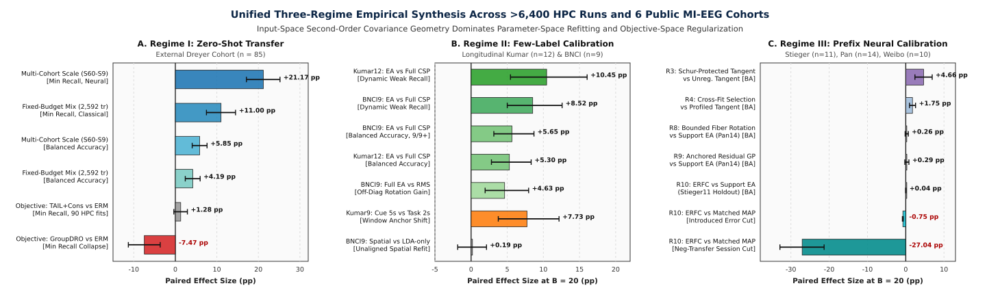
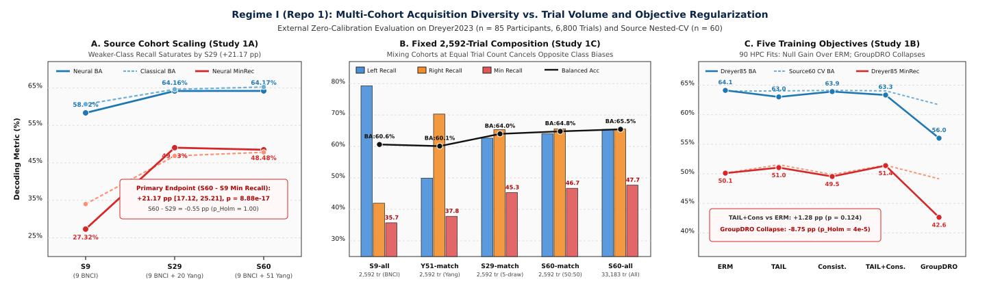
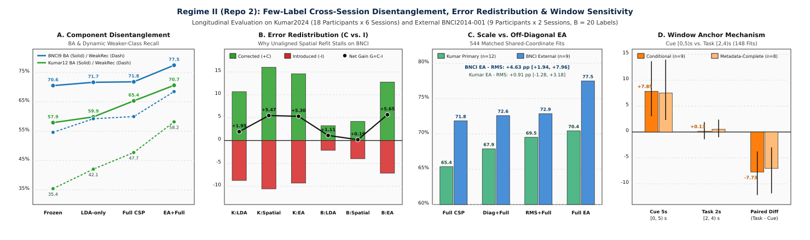
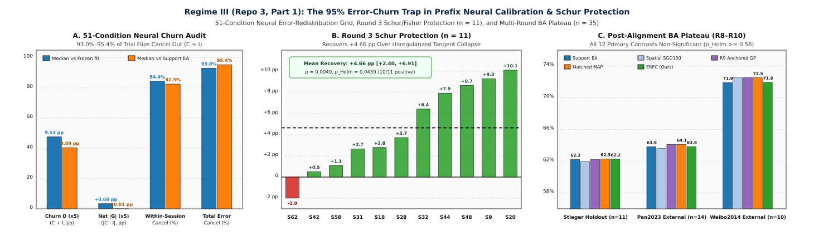
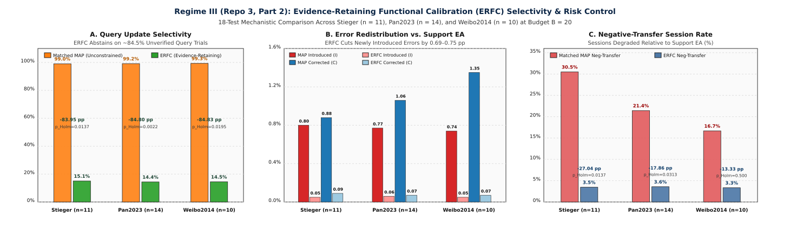

# Input-Space Covariance Geometry Dominates Parameter- and Objective-Space Adaptation in Motor Imagery EEG: A Multi-Regime Error-Redistribution Study

[](https://opensource.org/licenses/MIT)
[](#one-command-verification--figure-reproduction)
[](#overview--three-regime-scientific-synthesis)

**Authors:** Ziyuan Zhu\*, Sihao Liu, Haoyang Yu  
**Affiliation:** College of Artificial Intelligence Medicine, Chongqing Medical University, Chongqing 400016, China  
\*Corresponding Author: Ziyuan Zhu (`zzy2630816871@gmail.com`, ORCID: `0009-0005-1153-4926`)

---

## Overview & Three-Regime Scientific Synthesis

This repository is the **unified flagship manuscript, locked experimental evidence archive, and verification suite** integrating all completed high-performance computing (HPC) campaigns across three prior motor imagery electroencephalography (MI-EEG) research repositories (**88 remote Git branches**, **6 public multi-subject/multi-session MI-EEG cohorts**, and **>6,400 completed HPC evaluation tasks**):

1. **Regime I — Zero-Shot Cross-Subject Transfer** (from [`jackzhu119/cross-subject-mi-eeg`](https://github.com/jackzhu119/cross-subject-mi-eeg)):
   - Evaluates multi-cohort source scaling (`S9`, `S29`, `S60`), fixed-budget source cohort composition (locked at **2,592 training trials**, 90/90 classical `weighted_csp_rlda` tasks), and five training risk objectives (`ERM`, `TAIL`, `Consistency`, `TAIL+Consistency`, `GroupDRO`, 90/90 HPC tasks) on **BNCI2014-001** ($n=9$), **Yang2025** ($n=51$), and external **Dreyer2023** ($n=85$, 6,800 trials).
   - **Law I (Input Cohort Geometry vs. Objective Regularization)**: Single-cohort classifiers exhibit opposite class-boundary biases (BNCI left-biased: `79.29%` vs. `41.97%`; Yang right-biased: `49.94%` vs. `70.29%`). Mixing two source cohorts under a strictly fixed **2,592-trial budget** (`s60-matched`) cancels these opposite biases, yielding **+11.00 pp** in weaker-class recall (`Recall_min`: `35.71%` $\to$ `46.71%`) and **+4.19 pp** in balanced accuracy (BA: `60.63%` $\to$ `64.82%`), accounting for **>86%** of the gain from scaling $12.8\times$ to 33,183 trials (`s60-all`: `47.68%` `Recall_min`, `65.47%` BA). In neural models (`BROAD`), expanding from `S9` to `S60` increases external Dreyer85 `Recall_min` by **+21.17 pp** (`27.32%` $\to$ `48.48%`, $p = 8.88 \times 10^{-17}$, 72/85 improved) and saturates by `S29` (`S60 - S29` = **-0.55 pp**, $p_{\text{Holm}} = 1.000$). Conversely, across 90 HPC runs, complex tail/consistency objectives alter `Recall_min` by at most **+1.28 to +1.35 pp** ($p \ge 0.124$), while `GroupDRO` collapses on external transfer (**-8.75 pp**, $p_{\text{Holm}} = 4.0 \times 10^{-5}$).

2. **Regime II — Few-Label Longitudinal Cross-Session Recalibration** (from [`jackzhu119/few-shot-mi-eeg`](https://github.com/jackzhu119/few-shot-mi-eeg)):
   - Decomposes frozen transfer, classifier-only recalibration (`LDA-only`), joint spatial-classifier refitting (`Full CSP/LDA`), and pre-filter support-set Euclidean covariance alignment (`EA + Full CSP/LDA`) at calibration budget $B=20$ across **Kumar2024** ($n=18 \times 6$ sessions) and external **BNCI2014-001** ($n=9 \times 2$ sessions), supplemented by **544 shared-coordinate normalization geometry fits**, **148 paired time-window phase fits (`[0, 5) s` vs. `[2, 4) s`)**, and **150 Discovery V2/V3 covariance-mixing and neural BatchNorm-freezing tasks**.
   - **Law II (Pre-Filter Whitening Breaks Error Cancellation & Matches Window Physics)**: Unaligned spatial refitting (`Full - LDA-only`) fails on external BNCI9 (**+0.19 pp**, $p_{\text{Holm}} = 1.00$) because corrected errors ($C = 4.17\text{ pp}$) and newly introduced errors ($I = 3.98\text{ pp}$) suffer **97.73% mutual cancellation**. Pre-filter support-set whitening (`EA - Full`) achieves net positive error redistribution on both Kumar12 (**+5.30 pp**, $C=14.61, I=9.32$) and BNCI9 (**+5.65 pp**, $C=12.78, I=7.13$, 9/9 improved, $p_{\text{Holm}} = 0.0117$), boosting dynamic weaker-class recall by **+10.45 pp** and **+8.52 pp**. Mechanistically, broad cue-anchored windows (`[0, 5) s` on Kumar) are dominated by non-task global amplitude drift captured by scalar `Common RMS` (`69.52%` vs. `70.43%` `Full EA`; cropping to the 2 s task window `[2, 4) s` eliminates the extra `EA` gain by **-7.73 pp**), whereas compact task windows (BNCI9) require full off-diagonal covariance rotation (`Full EA` exceeds `Common RMS` by **+4.63 pp** `[+1.94, +7.96]`).

3. **Regime III — Prefix Neural, Manifold, and Evidence-Retaining Functional Calibration (ERFC)** (from [`jackzhu119/research3`](https://github.com/jackzhu119/research3)):
   - Synthesizes a 13-round HPC campaign (**>5,600 completed tasks**) adapting a multi-cohort source-pretrained `EEGNet` (`f0`) at prefix budgets $B \in \{4, 8, 12, 16, 20\}$ across **Stieger2021** ($n=11$, 105 sessions, 315 session-seed cells), **Pan2023** ($n=14$, 28 sessions, 84 cells), and **Weibo2014** ($n=10$, 10 sessions, 30 cells).
   - **Law III (The 95% Post-Whitening Error-Churn Trap, Schur Protection, & Selective ERFC)**: Unprotected second-order/tangent updates collapse by **-4.64 to -5.11 pp** ($p_{\text{Holm}} \le 0.0479$) due to ill-conditioned Fisher curvature; **Schur-complement head protection** (Round 3, 174/174 tasks) restores **+4.66 pp** ($p_{\text{Holm}} = 0.0439$, 10/11 positive). Yet even with protection, cross-fitted shrinkage (R4), coupled Lie rotations (R5), Laplace curvature averaging (R6), spatio-temporal Lie updates (R7), partial SPD transport & fiber rotation (R8, 2,835/2,835 tasks), and GP residual anchoring (R9, 1,548/1,548 tasks) all plateau within $\pm 0.65\text{ pp}$ of unsupervised `support_EA` ($p_{\text{Holm}} = 1.00$). A 51-condition trial-level error-redistribution audit reveals why: after `support_EA`, parameter updates flip a median **8.09%** of query predictions ($D = 8.09\text{ pp}$), but **95.35% of those flips cancel out** ($G = +0.01\text{ pp}$), inducing session-level negative transfer in **16.7%–30.5%** of sessions. **Evidence-Retaining Functional Calibration (ERFC)** (`profile-v1/a0.3-c0.1`, Round 10) abstains on ~84.5% of weak-evidence queries, matching `support_EA` and `matched_map` in mean BA across all three cohorts ($p_{\text{Holm}} \ge 0.5625$) while **cutting modified query trials by -83.95 to -84.83 pp** ($p_{\text{Holm}} \le 0.0195$), **reducing newly introduced errors by -0.69 to -0.75 pp** ($p_{\text{Holm}} \le 0.0313$), and **slashing session-level negative transfer by -13.33 to -27.04 pp** (Stieger $-27.04\text{ pp}$, $p_{\text{Holm}} = 0.0137$; Pan $-17.86\text{ pp}$, $p_{\text{Holm}} = 0.0313$).

---

## Visual Summary (Publication Figures 1–5)

| Figure | Description | Preview |
| :---: | :--- | :---: |
| **Figure 1** | **Three-Regime Synthesis**: Primary effect sizes across Regimes I–III and unified trial-level error redistribution ($C, I, D, G$) showing the transition from constructive net redistribution (input covariance geometry) to near-total cancellation churn (post-EA parameter updates) and selective churn suppression (`ERFC`). |  |
| **Figure 2** | **Regime I (Zero-Shot Transfer)**: Cohort scaling (`S9` $\to$ `S29` $\to$ `S60`), fixed 2,592-trial source-composition bias cancellation (`s9-all`, `y51-matched`, `s60-matched`), and 5-objective risk invariance (`ERM` vs. `TAIL+Cons` vs. `GroupDRO`). |  |
| **Figure 3** | **Regime II (Few-Label Longitudinal Recalibration)**: Four-stage component decomposition on Kumar12 & BNCI9, 544-fit normalization geometry (`Common RMS` vs. `Full EA`), and 148-fit temporal window mechanism (`[0, 5) s` cue window vs. `[2, 4) s` task window). |  |
| **Figure 4** | **Regime III (Post-EA Error Churn & Schur Protection)**: Round 3 Schur-complement Fisher protection recovery (**+4.66 pp**), Rounds 3–10 BA plateau around `support_EA`, and the 51-condition **95.35% error cancellation law**. |  |
| **Figure 5** | **Regime III (ERFC Selective Functional Calibration)**: Round 10 `ERFC` vs. unconstrained `matched_map` across Stieger2021 ($n=11$), Pan2023 ($n=14$), and Weibo2014 ($n=10$), demonstrating ~84.5% query update reduction, significant reduction in introduced errors, and -13.3 to -27.0 pp reduction in negative-transfer sessions. |  |

---

## Repository Directory Structure

```text
unified-mi-eeg-calibration/
├── README.md                                           # English project overview, lineage map, and verification guide
├── README_ZH.md                                        # Chinese project overview and synthesis guide
├── manuscript/                                         # Complete Flagship Manuscript & Supplementary Materials
│   ├── en/                                             # English main manuscript (Tables 1-6, Figs 1-5)
│   │   ├── Unified_MIEEG_Manuscript_EN.md
│   │   ├── Unified_MIEEG_Manuscript_EN.pdf
│   │   └── Unified_MIEEG_Manuscript_EN.docx
│   ├── zh/                                             # Chinese counterpart manuscript
│   │   ├── Unified_MIEEG_Manuscript_ZH.md
│   │   └── Unified_MIEEG_Manuscript_ZH.docx
│   └── supplementary/                                  # Tier 2 & Tier 3 Supplementary Materials (Tables S1-S8)
│       ├── Supplementary_Materials_EN.md
│       ├── Supplementary_Materials_EN.pdf
│       └── Supplementary_Materials_EN.docx
├── docs/                                               # Internal 88-Branch Synthesis & Merger Planning Reports
│   ├── master_experimental_synthesis_zh.md             # Complete 88-branch experimental inventory & synthesis report
│   └── merger_master_plan_zh.md                        # Scientific, statistical, and repository merger blueprint
├── figures/                                            # 5 Multi-Panel Publication Figures Categorized by Format
│   ├── png/                                            # 300 DPI PNG previews (Fig1–Fig5)
│   ├── pdf/                                            # Vector PDF figures (Fig1–Fig5)
│   └── svg/                                            # Editable SVG vector sources (Fig1–Fig5)
├── evidence_archive/                                   # Locked, Read-Only Experimental Result Snapshots from All 3 Repos
│   ├── DATA_LINEAGE_MANIFEST.json                      # Cryptographic SHA-256 & Git commit SHA provenance manifest
│   ├── regime1_zero_shot/                              # Extracted from jackzhu119/cross-subject-mi-eeg
│   ├── regime2_longitudinal/                           # Extracted from jackzhu119/few-shot-mi-eeg
│   └── regime3_prefix_erfc/                            # Extracted from jackzhu119/research3
└── scripts/                                            # Zero-GPU Post-Processing, Verification, & Figure Scripts
    ├── assemble_package.py                             # Package organizer, lineage manifest builder, & compiler
    ├── verify_all_tables.py                            # Audits all manuscript metrics against evidence_archive/
    └── build_svg_figures.py                            # Deterministic vector SVG/PDF/PNG figure generator
```

---

## Data Lineage & Provenance Across the Three Source Repositories

Every table and figure in this repository is traceably linked to locked result files from the three original repositories (full file-by-file SHA-256 hashes and commit SHAs are recorded in [`evidence_archive/DATA_LINEAGE_MANIFEST.json`](evidence_archive/DATA_LINEAGE_MANIFEST.json)):

| Regime | Source Repository | Source Branch | Git Commit SHA | Key Archived Evidence Packages |
| :---: | :--- | :--- | :---: | :--- |
| **Regime I** | [`jackzhu119/cross-subject-mi-eeg`](https://github.com/jackzhu119/cross-subject-mi-eeg) | `origin/main`<br>`origin/hpc-results/paper1-risk-v1`<br>`origin/hpc/paper1-composition-v2` | `c4ea1f4ee1`<br>`2afb6c3edd`<br>`38d3f71527` | • `ELIGIBLE_V3_RESULTS_20261018` (`S9`/`S29`/`S60` $\to$ Dreyer85)<br>• `paper1-risk-v1` (90/90 tasks, 5 objectives)<br>• `paper1-composition-v2` (90/90 classical fixed-2,592-trial composition tasks) |
| **Regime II** | [`jackzhu119/few-shot-mi-eeg`](https://github.com/jackzhu119/few-shot-mi-eeg) | `origin/research/paper2-alignment-integrated-revision`<br>`origin/research/paper2-hpc-v2-20261023` | `082310dc4c`<br>`da2a3acee2` | • Primary 4-stage decomposition & error redistribution (`Kumar12`, `BNCI9`)<br>• 544 shared-coordinate normalization geometry fits (`Full`, `Diag`, `RMS`, `EA`)<br>• 148 paired temporal window fits (`cue5s [0,5)s` vs. `task2s [2,4)s`)<br>• Discovery V2 (24/24 tasks) & Discovery V3 (126/126 tasks) |
| **Regime III** | [`jackzhu119/research3`](https://github.com/jackzhu119/research3) | `origin/main`<br>`origin/paper3-results`<br>`origin/paper3-r10-progress`<br>`origin/paper3-r12-progress`<br>`origin/paper3-r13-three-jobs-20261028` | `0365324ebc`<br>`321d3d5be7`<br>`5ad4d34438`<br>`b02f6e3615`<br>`8b74ef0f3b` | • 51-condition neural error-redistribution audit (`bmte-error-redistribution-20261029`)<br>• Rounds 2–9 completed archives (`R3` Schur protection, `R4` xfit, `R6` Laplace, `R8` 2,835 SPD/fiber tasks, `R9` 1,548 GP tasks)<br>• Round 10 `ERFC` (`profile-v1/a0.3-c0.1`, 429 session-seed cells, 18 mechanism tests)<br>• Round 12 (`M12`, 78/78 tasks) & Round 13 (`R13`, 96/96 tasks) |

---

## One-Command Verification & Figure Reproduction

No GPU or raw EEG retraining is required to audit the tables or regenerate the figures. Run:

```bash
# 1. Verify all manuscript tables (Tables 1-6 & Supplementary Tables S1-S8) against locked CSV/JSON archives
python3 scripts/verify_all_tables.py

# 2. Regenerate all 5 publication figures (SVG, 300 DPI PNG, and vector PDF under figures/{svg,png,pdf}/)
python3 scripts/build_svg_figures.py
```
