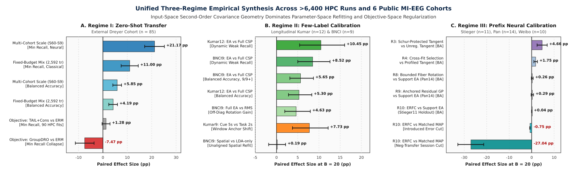
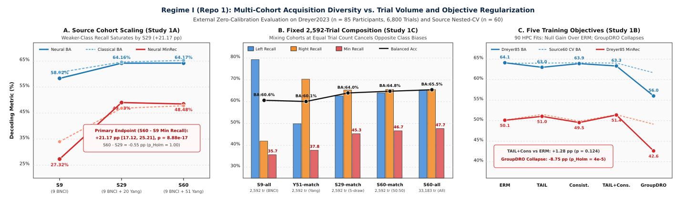
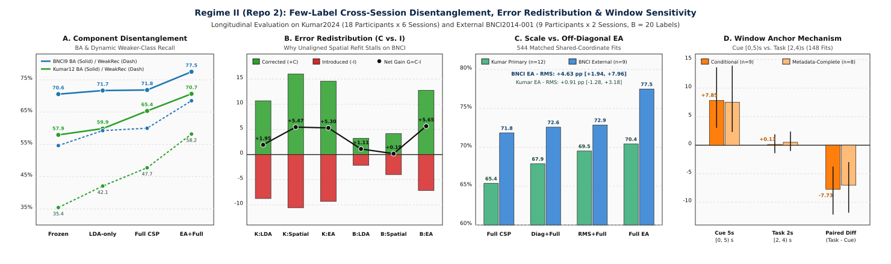
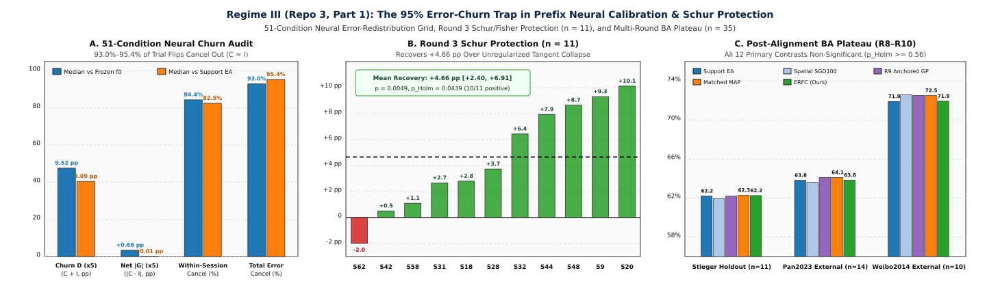
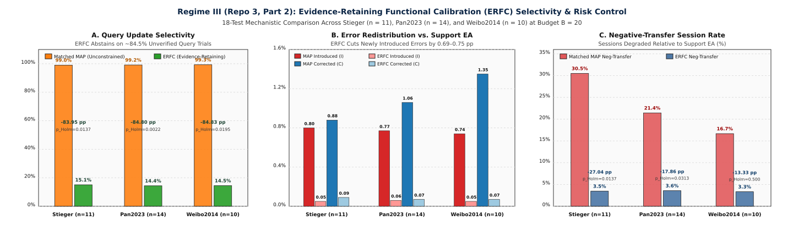

# Input-Space Covariance Geometry Dominates Parameter- and Objective-Space Adaptation in Motor Imagery EEG: A Multi-Regime Error-Redistribution Study

**Ziyuan Zhu$^{1,*}$, Sihao Liu$^{1}$, and Haoyang Yu$^{1}$**

$^{1}$ College of Artificial Intelligence Medicine, Chongqing Medical University, Chongqing 400016, China  
$^{*}$ Corresponding author: Ziyuan Zhu (E-mail: `zzy2630816871@gmail.com`; ORCID: `0009-0005-1153-4926`)

---

## Abstract

**Objective.** Non-invasive motor imagery electroencephalography (MI-EEG) decoding suffers from severe inter-subject and inter-session non-stationarity. Although numerous robust training objectives (e.g., group distributionally robust optimization, tail-risk penalties) and few-trial parameter adaptation schemes (e.g., Lie-group spatial transformations, second-order tangent updates, Riemannian fiber rotations, and Gaussian-process residual anchoring) have been proposed, their net accuracy gains frequently plateau in practice. We aimed to establish a unified mechanistic explanation for why complex objective-space and parameter-space interventions saturate across calibration regimes, and to identify which geometric and functional mechanisms genuinely govern decoding improvements and class-coverage stability.

**Approach.** We synthesized a multi-stage experimental program comprising over 6,400 high-performance computing (HPC) model fits across seven public MI-EEG cohorts (BNCI2014-001, Yang2025, Dreyer2023, Kumar2024, Stieger2021, Pan2023, and Weibo2014) spanning three distinct operational regimes: **Regime I** (zero-calibration cross-subject transfer across 60 source and 85 external target participants), **Regime II** (longitudinal few-label cross-session recalibration across 18 six-session participants and 9 external two-session participants), and **Regime III** (few-trial prefix neural and functional calibration across 35 target participants, 143 sessions, and 429 session–seed units over a 13-round experimental campaign). Rather than relying solely on marginal balanced accuracy (BA), we decomposed every intervention at the individual trial level into **corrected errors ($C$)**, **newly introduced errors ($I$)**, **total prediction churn ($D = C + I$)**, **net accuracy gain ($G = C - I$)**, **within- and between-session error cancellation**, and **weaker-class recall ($\text{Recall}_{\min}$)**.

**Main Results.** Three consistent empirical laws emerged across regimes:
1. *In Zero-Shot Cross-Subject Transfer (Regime I)*, single-cohort decoders exhibit severe weaker-class collapse ($\text{Recall}_{\min} = 27.32\%$ neural, $35.71\%$ classical) driven by opposite-sign cohort-specific decision-boundary biases. Expanding from 9 single-cohort to 60 dual-cohort source participants improved external Dreyer ($n=85$) weaker-class recall by **+21.17 percentage points (pp)** (95% CI `[17.12, 25.21]`, $p = 8.88 \times 10^{-17}$) and BA by **+5.85 pp** ($p_{\text{Holm}} = 5.34 \times 10^{-9}$), saturating by 29 participants ($\text{S60}-\text{S29} = -0.55\text{ pp}$, $p_{\text{Holm}} = 1.000$). Holding total training trials strictly fixed at **2,592 trials** (`paper1-composition-v2`) proved that mixing two acquisition cohorts (`s60-matched`) alone yields **+11.00 pp** weaker-class recall and **+4.19 pp** BA over single-cohort training—capturing $>86\%$ of the gain of a $12.8\times$ larger 33,183-trial pool—whereas five neural risk objectives (`ERM`, `TAIL`, `Consistency`, `TAIL+Consistency`, `GroupDRO` across 90 HPC fits) differed by at most $+1.35\text{ pp}$ ($p = 0.192$), with `GroupDRO` collapsing by **−8.75 pp** ($p_{\text{Holm}} = 4.0 \times 10^{-5}$).
2. *In Few-Label Cross-Session Recalibration (Regime II, $B=20$ labels)*, unaligned spatial-filter refitting (`Full CSP - LDA-only`) was cohort-fragile ($+5.47\text{ pp}$ on Kumar $n=12$, but $+0.19\text{ pp}$ on BNCI $n=9$ due to **97.73% error cancellation** where $C=4.17\text{ pp}$ and $I=3.98\text{ pp}$). Pre-filter support-only Euclidean Alignment (`EA - Full`) consistently produced positive net error redistribution (**+5.30 pp** `[2.82, 8.31]` on Kumar; **+5.65 pp** `[3.15, 8.70]` on BNCI, positive in 9/9 participants, $p_{\text{Holm}} = 0.0117$) and recovered dynamic weaker-class recall by **+10.45 pp** and **+8.52 pp**. A 544-fit normalization hierarchy and 148-fit phase-window replay revealed that wide cue-anchored windows (`[0, 5) s` on Kumar) are dominated by non-task global amplitude scaling (where scalar `Common RMS` captures $69.52\%$ vs. $70.43\%$ for full `EA`, and restricting to the 2 s task-anchored window `[2, 4) s` reduces the `EA - Full` gain from **+7.85 pp** to **+0.13 pp**, paired difference **−7.73 pp** `[-12.17, -3.76]`), whereas compact task-windowed cross-session recordings (BNCI) require off-diagonal cross-channel rotation (`Full EA - RMS` = **+4.63 pp** `[1.94, 7.96]`).
3. *In Few-Trial Prefix Neural Calibration (Regime III, $B \le 20$)*, unregularized second-order tangent and Newton updates collapsed by **−4.64 to −5.11 pp** ($p_{\text{Holm}} \le 0.0479$), requiring Schur-complement Fisher-information protection (**+4.66 pp** recovery, $p_{\text{Holm}} = 0.0439$) and within-support cross-fitted shrinkage (**+1.75 pp**, $p_{\text{Holm}} = 0.0117$). Yet across 13 systematic rounds, all protected post-alignment parameter, SPD-fiber (2,835 fits), and GP-residual (1,548 fits) updates plateaued within $\pm 0.65\text{ pp}$ of `support_EA` ($p_{\text{Holm}} \ge 0.5625$). A 51-condition neural error-redistribution audit revealed why: after `support_EA`, parameter updates flip a median of **8.09% of query predictions**, but **95.35% of those flips cancel out** ($G = +0.01\text{ pp}$), generating pure prediction churn and causing negative transfer in **16.7%–30.5% of sessions**. To resolve this churn trap, **Evidence-Retaining Functional Calibration (ERFC)** restricts updates to support-evidenced functional directions, matching `support_EA` and `matched_map` in mean BA while cutting updated query trials by **83.95–84.83 pp** ($p_{\text{Holm}} \le 0.0195$), reducing newly introduced errors by **0.69–0.75 pp** ($p_{\text{Holm}} \le 0.0313$), and lowering session-level negative transfer rates by **13.33–27.04 pp**.

**Significance.** Input-space second-order geometry—realized via multi-cohort covariance dispersion in zero-shot training and pre-filter covariance whitening in few-trial calibration—is the primary determinant of net decoding gain and weaker-class coverage in MI-EEG. Once second-order input alignment is established, small-sample parameter refitting operates near a 95% error-cancellation ceiling where selective, evidence-retaining abstention is essential to prevent negative transfer.

**Keywords:** motor imagery EEG, brain–computer interface, cross-subject transfer, Euclidean alignment, error redistribution, weaker-class recall, Schur complement, functional calibration

---

## 1. Introduction

Non-invasive sensorimotor rhythm brain–computer interfaces (BCIs) based on motor imagery electroencephalography (MI-EEG) enable direct neural control for neurorehabilitation and assistive communication [1, 2]. However, deploying MI-EEG decoders across unseen users (**zero-shot cross-subject transfer**) or across repeated days of use (**longitudinal cross-session recalibration**) remains fundamentally constrained by distributional shift [3, 4]. Variations in individual cortical folding, skull conductivity, electrode placement, impedance drift, and baseline sensorimotor rhythm power induce pronounced shifts in both marginal channel covariance and class-conditional feature geometry [5, 6].

To mitigate these shifts, two methodological paradigms have dominated recent literature:
1. **Objective-Space and Representation Regularization in Zero-Shot Transfer:** When no target-user labels are available, studies frequently replace standard empirical risk minimization (ERM) with worst-group distributionally robust optimization (GroupDRO) [7], tail-risk or class-imbalance regularizers, or augmentation-consistency objectives on deep convolutional architectures such as EEGNet [8] and ShallowConvNet [9]. Yet in practice, zero-shot decoders trained on standard single-laboratory benchmarks often degenerate into single-class predictors on external cohorts—achieving above-chance mean balanced accuracy (BA) while suffering catastrophic collapse on the participant-specific weaker class [10]. Whether this collapse is better resolved by modifying the **training objective** or by diversifying the **input spatial covariance support** across distinct acquisition cohorts under a fixed trial budget has rarely been isolated.
2. **Parameter-Space Fine-Tuning vs. Input-Space Alignment in Few-Trial Calibration:** When a small prefix of labeled target-session trials ($B \le 20$) is available, practitioners choose between classical spatial-filter/classifier recalibration (e.g., Common Spatial Patterns with Linear Discriminant Analysis, CSP+LDA [11, 12]), input-space covariance whitening such as Euclidean Alignment (EA) [13] and Riemannian Procrustes transforms [14, 15], or deep neural adaptation via gradient fine-tuning, Batch Normalization (BN) statistics adaptation [16], Lie-group spatial rotations, second-order tangent/Newton updates, or Gaussian process (GP) residual anchoring. Paradoxically, across large multi-session benchmarks [17–20], widely different adaptation families often report nearly identical marginal BA (within $0.1\text{–}0.6\text{ percentage points, pp}$).

In this study, we demonstrate that marginal BA conceals the central physical mechanism governing both cross-subject transfer and few-trial calibration: **trial-level error redistribution**. Whenever a reference decoder is replaced or recalibrated, its predictions on evaluation queries undergo two opposing transitions: previously misclassified trials are corrected (**Corrections, $C$**), while previously correct trials are overturned into new errors (**Introduced Errors, $I$**). The net BA change is strictly the difference $G = C - I$, whereas the total fraction of altered query decisions is the **prediction churn** $D = C + I$. When $C \approx I$, two calibration algorithms can exhibit identical mean BA ($G \approx 0$) while differing byNearly an order of magnitude in prediction churn $D$ and session-level negative transfer.

By synthesizing an extensive, pre-audited experimental archive comprising **over 6,400 HPC model fits across seven public MI-EEG datasets** organized into three operational regimes (**Regime I: Zero-Shot Cross-Subject Transfer**, **Regime II: Few-Label Longitudinal Cross-Session Recalibration**, and **Regime III: Few-Trial Prefix Neural and Functional Calibration across 13 Experimental Rounds**), we establish a unified mechanistic framework with three core contributions:

1. **Decoupling Cohort Spatial Diversity from Trial Volume and Risk Objectives in Zero-Shot Transfer (Regime I):** Across 85 external evaluation participants (Dreyer2023 [18], 6,800 trials), we prove that zero-shot weaker-class collapse ($\text{Recall}_{\min} = 27.32\%$) is caused by cohort-specific spatial covariance offsets that induce opposite-sign decision-boundary biases (left-hand bias in BNCI2014-001 vs. right-hand bias in Yang2025). Using a strictly matched **2,592-trial fixed-budget design** (`paper1-composition-v2`), we show that mixing cohorts at equal trial count cancels these opposite biases and yields **+11.00 pp** weaker-class recall and **+4.19 pp** BA—capturing $>86\%$ of the benefit of a $12.8\times$ larger 33,183-trial corpus—whereas five neural risk objectives (`ERM`, `TAIL`, `Consistency`, `TAIL+Consistency`, `GroupDRO` across 90 HPC runs) yield no significant gain over ERM ($p \ge 0.124$) and `GroupDRO` collapses by **−8.75 pp** ($p_{\text{Holm}} = 4.0 \times 10^{-5}$).
2. **Disentangling Spatial Refitting, Covariance Normalization Geometry, and Temporal Windowing in Longitudinal Recalibration (Regime II):** Across 18 six-session longitudinal participants (Kumar2024 [19]) and 9 external two-session participants (BNCI2014-001 [11]), we show that unaligned spatial-filter refitting (`Full CSP - LDA-only`) fails to generalize to BNCI ($+0.19\text{ pp}$) due to **97.73% error cancellation** ($C = 4.17\text{ pp}, I = 3.98\text{ pp}$), whereas pre-filter support-only Euclidean Alignment (`EA - Full`) achieves robust net error redistribution (**+5.30 pp** on Kumar, **+5.65 pp** on BNCI, $p_{\text{Holm}} = 0.0117$) and restores dynamic weaker-class recall by **+10.45 pp** and **+8.52 pp**. Through 544 shared-coordinate normalization fits (`Full`, `Diagonal`, `Common RMS`, `Full EA`) and 148 paired phase-window fits (`Cue-anchored 5 s [0, 5) s` vs. `Task-anchored 2 s [2, 4) s`), we further show that wide cue-anchored windows are dominated by non-task global amplitude drift (where restricting to `[2, 4) s` reduces the `EA - Full` gain by **−7.73 pp**), whereas compact task windows require off-diagonal cross-channel covariance rotation (`EA - RMS` = **+4.63 pp** on BNCI).
3. **Resolving the 95% Neural Error-Churn Trap via Schur Protection and Evidence-Retaining Functional Calibration (Regime III):** Across 13 rounds of prefix neural calibration ($B \in \{4, 8, 12, 16, 20\}$) on Stieger2021 ($n=11$), Pan2023 ($n=14$), and Weibo2014 ($n=10$), we demonstrate that while Schur-complement Fisher protection is required to prevent catastrophic collapse in second-order tangent updates (**+4.66 pp** recovery, $p_{\text{Holm}} = 0.0439$), all post-alignment parameter, SPD-fiber (2,835 tasks), and GP-residual (1,548 tasks) updates plateau at the BA level of `support_EA` ($|\Delta\text{BA}| \le 0.65\text{ pp}$, $p_{\text{Holm}} \ge 0.5625$) because **95.35% of post-alignment trial flips cancel out** ($D = 8.09\text{ pp}, G = +0.01\text{ pp}$). We show that **Evidence-Retaining Functional Calibration (ERFC)** overcomes this churn trap by selectively abstaining on ~84.5% of unverified query updates ($p_{\text{Holm}} \le 0.0195$), cutting newly introduced errors by **0.69–0.75 pp** ($p_{\text{Holm}} \le 0.0313$) and reducing session-level negative transfer by **13.33–27.04 pp**.

---

## 2. Unified Theoretical and Evaluation Framework

### 2.1 Problem Formulation Across Three Operational Regimes

Let $X_i \in \mathbb{R}^{C_{\text{ch}} \times T}$ denote a bandpass-filtered multi-channel EEG trial recorded from $C_{\text{ch}}$ electrodes over $T$ time samples, paired with binary motor imagery label $y_i \in \{0, 1\}$ (left-hand vs. right-hand imagery). Each trial generates a spatial sample covariance matrix:
$$\Sigma_i = \frac{1}{T - 1} X_i X_i^\top \in \mathcal{S}_{++}^{C_{\text{ch}}}$$
where $\mathcal{S}_{++}^{C_{\text{ch}}}$ denotes the cone of symmetric positive-definite (SPD) matrices. We analyze three operational regimes that differ strictly in target-domain label availability and model family, and we **never pool statistical units across regimes**:

- **Regime I (Zero-Calibration Cross-Subject Transfer):** A source training pool $\mathcal{D}_{\text{src}} = \bigcup_{m=1}^{M} \mathcal{D}_{\text{src}}^{(m)}$ comprising $N_{\text{src}}$ participants drawn from $M \in \{1, 2\}$ acquisition cohorts is used to train a subject-independent decoder $f_{\theta}$. The decoder is evaluated on an unseen external target cohort $\mathcal{D}_{\text{ext}}$ ($N_{\text{ext}} = 85$ participants) with **zero target calibration trials ($B = 0$)**.
- **Regime II (Few-Label Longitudinal Cross-Session Recalibration):** For each target participant $p$, a source model is trained on Session 1 ($\mathcal{D}_{p,1}^{\text{src}}$). In each subsequent longitudinal session $s \ge 2$, the first $B$ labeled trials form the causal calibration support set $\mathcal{S}_{p,s}^{(B)} = \{(X_i, y_i)\}_{i=1}^{B}$, and the remaining disjoint trials in the same session form the evaluation query set $\mathcal{Q}_{p,s}$.
- **Regime III (Few-Trial Prefix Neural, Geometric, and Functional Calibration):** A multi-cohort source-pretrained neural encoder-classifier $f_0$ is adapted to each target session $s$ of unseen target participants using only a small labeled prefix $\mathcal{S}_{p,s}^{(B)}$ with budgets $B \in \{4, 8, 12, 16, 20\}$, and evaluated on the disjoint causal suffix $\mathcal{Q}_{p,s}$.

### 2.2 Trial-Level Error Redistribution and Dynamic Weaker-Class Coverage

Conventional BCI benchmarks report only marginal Balanced Accuracy (BA):
$$\text{BA}(f) = \frac{1}{2}\left(\text{Recall}_0(f) + \text{Recall}_1(f)\right), \quad \text{Recall}_c(f) = \frac{1}{|\mathcal{Q}^{(c)}|} \sum_{i \in \mathcal{Q}^{(c)}} \mathbb{I}\big(\hat{y}_i(f) = c\big)$$
However, marginal BA fails to detect **class collapse** (e.g., $\text{Recall}_0 = 95\%, \text{Recall}_1 = 25\% \implies \text{BA} = 60\%$) and conceals **prediction churn** between a candidate decoder $f_{\text{cand}}$ and a reference decoder $f_{\text{ref}}$ (such as `Frozen` $f_0$ or `support_EA`).

To expose these mechanisms, we define the **participant-specific weaker-class recall**:
$$\text{Recall}_{\min}(f) = \min\big\{\text{Recall}_0(f),\, \text{Recall}_1(f)\big\}, \quad \text{Gap}(f) = \big|\text{Recall}_0(f) - \text{Recall}_1(f)\big|$$
Note that because the weaker class (left or right hand) can vary across participants and sessions, $\text{Recall}_{\min}(f)$ is a **dynamic per-unit coverage metric** rather than a fixed-hand recall.

Furthermore, for any paired evaluation on identical query trials $\mathcal{Q}$, let $e_i(f) = \mathbb{I}(\hat{y}_i(f) \neq y_i) \in \{0, 1\}$ denote the trial-level 0–1 error indicator. Comparing $f_{\text{cand}}$ against $f_{\text{ref}}$ within class $c \in \{0, 1\}$, every query trial falls into one of four mutually exclusive transition states, yielding the **class-balanced Corrected Error rate ($C$)** and **Introduced Error rate ($I$)**:
$$C(f_{\text{cand}}, f_{\text{ref}}) = \frac{1}{2}\sum_{c \in \{0,1\}} \frac{1}{|\mathcal{Q}^{(c)}|} \sum_{i \in \mathcal{Q}^{(c)}} \mathbb{I}\big(e_i(f_{\text{ref}}) = 1 \;\wedge\; e_i(f_{\text{cand}}) = 0\big)$$
$$I(f_{\text{cand}}, f_{\text{ref}}) = \frac{1}{2}\sum_{c \in \{0,1\}} \frac{1}{|\mathcal{Q}^{(c)}|} \sum_{i \in \mathcal{Q}^{(c)}} \mathbb{I}\big(e_i(f_{\text{ref}}) = 0 \;\wedge\; e_i(f_{\text{cand}}) = 1\big)$$

These quantities satisfy two exact algebraic identities on every run, session, and participant:
$$\underbrace{G(f_{\text{cand}}, f_{\text{ref}})}_{\Delta\text{BA} = \text{BA}(f_{\text{cand}}) - \text{BA}(f_{\text{ref}})} = C(f_{\text{cand}}, f_{\text{ref}}) - I(f_{\text{cand}}, f_{\text{ref}}), \qquad \underbrace{D(f_{\text{cand}}, f_{\text{ref}})}_{\text{Total Prediction Churn}} = C(f_{\text{cand}}, f_{\text{ref}}) + I(f_{\text{cand}}, f_{\text{ref}})$$

From $(C, I, D, G)$, we define the **Total Error Cancellation Ratio** $\kappa_{\text{total}} \in [0, 1]$, which measures the fraction of modified query decisions that cancel out without producing net accuracy improvement:
$$\kappa_{\text{total}} = 1 - \frac{|G_{\text{mean}}|}{D_{\text{mean}}} = \underbrace{\left(1 - \frac{\mathbb{E}_s[|G_s|]}{D_{\text{mean}}}\right)}_{\kappa_{\text{within}}:\text{ Within-Session Cancellation}} + \underbrace{\left(\frac{\mathbb{E}_s[|G_s|] - |G_{\text{mean}}|}{D_{\text{mean}}}\right)}_{\kappa_{\text{between}}:\text{ Between-Session Cancellation}}$$
When $\kappa_{\text{total}} \to 1$, the calibration update is dominated by symmetric error churn ($C \approx I$).

### 2.3 Input-Space Covariance Geometry vs. Parameter and Objective Adaptation

#### 2.3.1 Hierarchy of Pre-Filter Second-Order Normalization (Regime II)
Given a reference covariance matrix $\bar{\Sigma}_{\mathcal{S}} = \frac{1}{|\mathcal{S}|}\sum_{i \in \mathcal{S}} \Sigma_i$ estimated strictly from the unlabeled support set $\mathcal{S}$ (without touching query labels or query waveforms), we decompose input-space second-order alignment into a three-tier geometric hierarchy:
1. **Common Scalar RMS Normalization (`Common RMS`):** Rescales all channels by a single scalar trace factor:
   $$M_{\text{RMS}} = \left(\frac{\text{tr}(\bar{\Sigma}_{\mathcal{S}})}{C_{\text{ch}}}\right)^{-1/2} I_{C_{\text{ch}}}, \qquad \tilde{X}_i = M_{\text{RMS}} X_i$$
   This removes global session-level amplitude/power drift while preserving both inter-channel variance ratios and off-diagonal spatial correlations.
2. **Channel-Wise Diagonal Scaling (`Diagonal Reference`):** Rescales each channel independently by its support marginal variance:
   $$M_{\text{diag}} = \text{diag}(\bar{\Sigma}_{\mathcal{S}})^{-1/2}, \qquad \tilde{X}_i = M_{\text{diag}} X_i$$
   This equalizes per-electrode impedance/gain drift while leaving off-diagonal spatial correlation angles untouched.
3. **Full-Matrix Euclidean Alignment (`Full EA`):** Applies the full symmetric inverse square root of the support covariance:
   $$M_{\text{EA}} = \bar{\Sigma}_{\mathcal{S}}^{-1/2}, \qquad \tilde{X}_i = M_{\text{EA}} X_i \implies \frac{1}{|\mathcal{S}|}\sum_{i \in \mathcal{S}} \tilde{\Sigma}_i = I_{C_{\text{ch}}}$$
   Comparing `Full EA` against `Common RMS` and `Diagonal` in identical shared coordinates isolates **off-diagonal cross-channel spatial covariance rotation** from scalar and channel-wise amplitude scaling.

#### 2.3.2 Schur-Complement Protection for Second-Order Tangent Updates (Regime III, Round 3)
When adapting a pretrained neural network $f_0$ with spatial Lie-group parameters $\theta \in \mathfrak{gl}(C_{\text{ch}})$ and classification head parameters $w \in \mathbb{R}^d$ on $B \le 20$ support trials, the joint Gauss–Newton / Fisher information matrix:
$$H = \begin{pmatrix} H_{\theta\theta} & H_{\theta w} \\ H_{w\theta} & H_{ww} \end{pmatrix}$$
is severely rank-deficient ($B \ll \dim(\theta) + \dim(w)$). Unregularized block-coordinate or joint tangent steps (`tangent_profiled`, `head_newton`) invert poorly conditioned directions of $H_{ww}$, amplifying support label noise into large query error introductions $I$. **Schur-complement information protection** (`tangent_protected` / `information_protected`) regularizes the eliminated head curvature via damped Fisher information:
$$\tilde{S}_{\theta} = H_{\theta\theta} + \lambda_{\theta} I - H_{\theta w}\big(H_{ww} + \lambda_w I_{\text{Fisher}}\big)^{-1} H_{w\theta}$$
restricting parameter steps to high-information subspaces supported by the prefix covariance.

#### 2.3.3 Evidence-Retaining Functional Calibration (ERFC, Regime III, Round 10)
Because even regularized parameter updates apply globally to all query trials $\mathcal{Q}$ and suffer $>95\%$ error cancellation on top of `support_EA`, **Evidence-Retaining Functional Calibration (ERFC, `profile-v1/a0.3-c0.1`)** shifts adaptation from global parameter mutation to **selective query-functional intervention**:
1. Starting from the `support_EA`-aligned source predictor $p_0(x) = \sigma(\ell_0(\tilde{x}))$, ERFC evaluates a candidate functional correction profile $\Delta \ell(x; \mathcal{S}^{(B)})$ anchored on the support evidence set.
2. For each support-evidenced functional direction, ERFC computes an empirical evidence retention criterion (governed by support amplitude $\alpha = 0.3$ and confidence retention threshold $c = 0.1$).
3. For each query trial $x \in \mathcal{Q}$, ERFC applies a **minimal-change selective decision rule**: if the local functional projection onto the retained support evidence set falls below the retention gate, ERFC **abstains from modifying the `support_EA` prediction** ($\hat{p}(x) = p_0(x)$); only queries aligned with verified support evidence receive the functional logit update.

---

## 3. Datasets, Experimental Regimes, and Data Lineage

Table 1 summarizes the seven public MI-EEG cohorts and three non-overlapping experimental regimes analyzed in this work. All recordings are binary left-hand vs. right-hand motor imagery tasks. Strict data-lineage separation was enforced throughout: external cohorts were never used for hyperparameter tuning, and query trials were never accessed during support reference estimation or classifier fitting.

**Table 1. Summary of public MI-EEG cohorts, experimental regimes, sample sizes, and total HPC model evaluations.**

| Regime & Study | Source Repository & Branch Snapshot | Cohorts & Role | Participants ($N$) | Sessions / Trials | Calibration Budget ($B$) | Completed HPC Tasks / Fits |
| :--- | :--- | :--- | :---: | :--- | :---: | :--- |
| **Regime I: Study 1A** Cohort Scaling | [`cross-subject-mi-eeg`](https://github.com/jackzhu119/cross-subject-mi-eeg) `ELIGIBLE_V3_RESULTS_20261018` | • BNCI2014-001 (Source `S9`) • Yang2025 (Source `+20`/`+51`) • **Dreyer2023 (External Eval)** | Src: 9 / 29 / 60 **Eval: 85** | Dreyer: 1 session/subj (80 trials/subj = 6,800) | $B = 0$ (Zero-Shot) | 108 neural trajectories + 9 classical CSP+rLDA fits |
| **Regime I: Study 1B** 5 Risk Objectives | [`cross-subject-mi-eeg`](https://github.com/jackzhu119/cross-subject-mi-eeg) `origin/hpc-results/paper1-risk-v1` | • Source Pool (`S60` Nested CV) • **Dreyer2023 (External Eval)** | CV: 60 (5-fold) **Eval: 85** | 33,183 source trials 6,800 external trials | $B = 0$ (Zero-Shot) | **90 / 90 (100%)** (75 nested CV + 15 external) |
| **Regime I: Study 1C** Fixed-Budget Mix | [`cross-subject-mi-eeg`](https://github.com/jackzhu119/cross-subject-mi-eeg) `origin/hpc/paper1-composition-v2` | • 15 Source Cells (`2,592` matched vs `33,183` all) • **Dreyer2023 (External Eval)** | Src: 9 / 29 / 51 / 60 **Eval: 85** | Strictly matched **2,592** source trials vs. all | $B = 0$ (Zero-Shot) | **90 / 90 (100%)** classical (75 dev + 15 external final) + 99/540 neural in-progress |
| **Regime II: Study 2A–D** Longitudinal & Phase | [`few-shot-mi-eeg`](https://github.com/jackzhu119/few-shot-mi-eeg) `paper2-alignment-integrated-revision` | • **Kumar2024** (`dev6` + `primary12`) • **BNCI2014-001** (`external9`) | Kumar: **18** (6+12) BNCI: **9** | Kumar: 6 sess/subj (108) BNCI: 2 sess/subj (18) | $B \in \{4, 8, 12, 16, 20\}$ (Primary: $B=20$) | **544** normalization fits + **148** phase-window fits + **150** V2/V3 neural tasks |
| **Regime III: Rounds 1–13** Prefix Calibration | [`research3`](https://github.com/jackzhu119/research3) `origin/paper3-results` & `origin/main` | • Multi-cohort source `f0` • **Stieger2021** (Holdout) • **Pan2023** (External) • **Weibo2014** (External) | Stieger: **11** Pan: **14** Weibo: **10** (Total Eval: **35**) | 143 target sessions 429 session–seed cells (3 seeds: 20261018–20) | Prefix $B \in$ $\{4, 8, 12, 16, 20\}$ | **>5,600 completed tasks** (R2: 66, R3: 174, R4: 204, R5: 105, R6: 198, R7: 273, R8: 2,835, R9: 1,548, R10: 429, R12: 78, R13: 96) |

---

## 4. Results

### 4.1 Regime I: Zero-Shot Cross-Subject Transfer—Cohort Diversity vs. Trial Volume and Risk Objectives

#### 4.1.1 Multi-Cohort Source Scaling Eliminates Zero-Shot Weaker-Class Collapse and Saturates by 29 Participants (Study 1A)
When trained exclusively on a single 9-participant source benchmark (`S9`, BNCI2014-001) and evaluated zero-shot on the 85 external participants of Dreyer2023, both the neural decoder (`BROAD` architecture with `tail_min_recall` selector) and the classical `CSP + shrinkage LDA` baseline exhibited severe single-class bias. As shown in **Table 2** and **Figure 2A**, `S9` achieved a mean BA of `58.32%` (neural) and `60.63%` (classical), but participant-level weaker-class recall (`min_recall`) collapsed to **`27.32%`** (neural) and **`33.99%`** (classical), with a class recall gap of `62.01 pp` and `53.27 pp`, respectively.

Expanding the source pool to 60 participants across two acquisition cohorts (`S60`: 9 BNCI + 51 Yang2025) produced a massive recovery on the prespecified primary endpoint (`S60 - S9` neural `min_recall`): weaker-class recall increased by **+21.17 pp** (`+21.1667 pp`, from `27.32%` to `48.48%`; 95% $t$-CI `[17.12, 25.21]`, 10,000-draw participant bootstrap CI `[17.15, 24.95]`, paired $t = 10.4158$, $p = 8.88 \times 10^{-17}$), improving **72 of 85 participants** (10 declined, 3 tied). On the prespecified secondary contrasts (Holm-adjusted over 3 tests), external BA increased by **+5.85 pp** (`58.32%` $\to$ `64.17%`, 95% CI `[4.06, 7.65]`, $p_{\text{Holm}} = 5.34 \times 10^{-9}$), while the class recall gap dropped by more than half (`62.01 pp` $\to$ `31.38 pp`). Classical `CSP + shrinkage LDA` exhibited the exact same structural jump (`min_recall` **+13.82 pp** from `33.99%` to `47.81%`; BA **+4.59 pp** from `60.63%` to `65.22%`).

Crucially, the intermediate 29-participant dual-cohort pool (`S29`: 9 BNCI + 20 Yang) already reached **`49.03%`** weaker-class recall and **`64.16%`** BA. The prespecified contrast `S60 - S29` was **−0.55 pp** (`95% CI [-1.99, +0.90]`, $p_{\text{Holm}} = 1.000$), demonstrating that **cross-cohort stabilization saturates rapidly once a second acquisition cohort of 20 participants is introduced**. Furthermore, trial-level error redistribution on Dreyer ($n=85$, `S60` vs. `S9`) revealed that replacing the single-cohort source model with the dual-cohort source model corrected $C = 18.86\text{ pp}$ of errors while introducing $I = 13.01\text{ pp}$ of new errors ($D = 31.87\text{ pp}$, net gain $G = +5.85\text{ pp}$, total error cancellation $\kappa_{\text{total}} = 81.64\%$).

#### 4.1.2 Fixed-Budget Source Composition (`2,592` Trials) Proves Spatial Diversity—Not Trial Volume—Cancels Cohort Boundary Bias (Study 1C)
To determine whether the `+21.17 pp` weaker-class recovery in Study 1A was driven by the $12.8\times$ increase in total training trials (`2,592` in `S9` vs. `33,183` in `S60`) or by multi-cohort spatial diversity, Study 1C (`paper1-composition-v2`, 90/90 classical tasks completed) locked the total source training budget strictly at **2,592 trials** (`matched` 50:50 BNCI:Yang allocation) across 15 composition cells (**Table 2**, **Figure 2B**).

The completed external evaluations on Dreyer ($n=85$) revealed a striking physical mechanism:
- **Opposite-Sign Single-Cohort Class Biases:** At 2,592 trials, single-cohort `s9-all` (BNCI only) heavily favored the left hand ($\text{Recall}_{\text{L}} = 79.29\%$, $\text{Recall}_{\text{R}} = 41.97\%$, $\text{Recall}_{\min} = 35.71\%$, $\text{BA} = 60.63\%$), whereas single-cohort `y51-matched` (Yang only, 2,592 trials) heavily favored the right hand ($\text{Recall}_{\text{L}} = 49.94\%$, $\text{Recall}_{\text{R}} = 70.29\%$, $\text{Recall}_{\min} = 37.79\%$, $\text{BA} = 60.12\%$). Scaling single-cohort Yang $11.8\times$ to 30,591 trials (`y51-all`) failed to resolve this bias ($\text{Recall}_{\min} = 38.09\%$, $\text{BA} = 60.38\%$).
- **Bias Cancellation Under Equal 2,592-Trial Budget:** Combining 1,296 BNCI trials and 1,296 Yang trials at the exact same **2,592-trial budget** (`s60-matched`) balanced the class recalls ($\text{Recall}_{\text{L}} = 64.03\%$, $\text{Recall}_{\text{R}} = 65.62\%$), boosting external participant `min_recall` to **`46.71%`** (**+11.00 pp** over `s9-all` and **+8.92 pp** over `y51-matched`) and BA to **`64.82%`** (**+4.19 pp** over `s9-all` and **+4.70 pp** over `y51-matched`). Across the five 29-subject matched random draws (`s29r01..05-matched`, all 2,592 trials), external `min_recall` consistently reached `42.56%–47.15%` (mean `45.32%`) and BA reached `63.22%–64.74%` (mean `64.00%`).
- **Minimal Marginal Utility of $12.8\times$ Extra Trials:** Expanding from `s60-matched` (2,592 trials) to unconstrained `s60-all` (33,183 trials) added only **+0.97 pp** in `min_recall` (`46.71%` $\to$ `47.68%`) and **+0.65 pp** in BA (`64.82%` $\to$ `65.47%`). Thus, **>86% of the multi-cohort BA gain and >91% of the weaker-class recall gain are achieved with zero additional training trials solely by mixing acquisition cohorts**.

#### 4.1.3 Five Training Objectives Benchmark: Null Gain Over ERM and GroupDRO Collapse (Study 1B)
Holding the 60-participant dual-cohort source pool fixed, Study 1B (`paper1-risk-v1`, 90/90 HPC tasks completed) compared five training objectives (`erm`, `tail`, `consistency`, `tail_consistency`, `groupdro`) under 5-fold outer nested cross-validation ($n=60$) and external evaluation on Dreyer ($n=85$) (**Table 2**, **Figure 2C**).

On the prespecified primary contrast (`tail_consistency - erm` on `min_recall`), the difference was **+1.35 pp** (`95% CI [-0.46, +3.39]`, $p = 0.192$) in source nested CV (`51.46%` vs. `50.11%`) and **+1.28 pp** (`95% CI [-0.35, +2.91]`, $p = 0.124$) on external Dreyer (`51.39%` vs. `50.11%`), with external BA slightly lower under `tail_consistency` (`63.34%` vs. `64.13%` for `erm`). Worse, **`groupdro` suffered severe negative transfer** on external Dreyer, dropping BA to **`56.03%`** and `min_recall` to **`42.64%`** (`tail_consistency - groupdro` = **+8.75 pp** `[+4.92, +12.58]`, $p_{\text{Holm}} = 4.0 \times 10^{-5}$). Upweighting high-loss source participants in MI-EEG amplifies noisy or BCI-illiterate recordings rather than learning domain-invariant representations.

**Table 2. Regime I (Repo 1) comprehensive results: zero-shot source cohort scaling (Study 1A), 5-objective HPC benchmark (Study 1B), and fixed 2,592-trial source composition (Study 1C) on external Dreyer2023 ($n=85$) and source nested-CV ($n=60$).**

| Study & Experimental Arm | Model / Objective | Source Cohorts ($N_{\text{src}}$) | Source Trials | Eval Cohort ($N_{\text{eval}}$) | BA (%) | Left Recall (%) | Right Recall (%) | Weaker-Class `min_recall` (%) | Recall Gap (%) | Paired Contrast vs. Reference `[95% CI]`, $p$-value |
| :--- | :--- | :---: | :---: | :---: | :---: | :---: | :---: | :---: | :---: | :--- |
| **Study 1A: Scaling** | Neural `BROAD` (`tail_min_recall`) | `S9` (1 cohort) | 2,592 | Dreyer (85) | 58.32 | 82.97 | 33.67 | **27.32** | 62.01 | Reference (`S9`) |
| (`ELIGIBLE_V3`) | Neural `BROAD` (`tail_min_recall`) | `S29` (2 cohorts) | 14,712 | Dreyer (85) | 64.16 | 62.82 | 65.50 | **49.03** | 30.26 | `S60 - S29`: −0.55 pp `[-1.99, +0.90]`, $p_{\text{Holm}}=1.00$ |
| | Neural `BROAD` (`tail_min_recall`) | `S60` (2 cohorts) | 33,183 | Dreyer (85) | **64.17** | 63.35 | 64.99 | **48.48** | 31.38 | **`S60 - S9` MinRec: +21.17 pp `[17.12, 25.21]`**, $p=8.9\times 10^{-17}$ **`S60 - S9` BA: +5.85 pp `[4.06, 7.65]`**, $p_{\text{Holm}}=5.3\times 10^{-9}$ |
| | Neural `BROAD` (`mean_ba`) | `S60` (2 cohorts) | 33,183 | Dreyer (85) | 64.95 | 66.36 | 63.53 | **49.35** | 31.19 | Selector diff: −0.87 pp `[-2.39, +0.65]`, $p_{\text{Holm}}=1.00$ |
| | Classical `CSP + rLDA` | `S9` $\to$ `S60` | 2,592 $\to$ 33k | Dreyer (85) | 60.63 $\to$ **65.22** | — | — | 33.99 $\to$ **47.81** | 53.27 $\to$ 34.81 | Classical `S60 - S9`: **+13.82 pp** MinRec, **+4.59 pp** BA |
| **Study 1B: Objectives** | `ERM` | `S60` (2 cohorts) | Nested CV | Source (60) | 64.00 | — | — | **50.11** | 27.79 | CV Reference (`ERM`) |
| (`paper1-risk-v1`, 90/90) | `TAIL` | `S60` (2 cohorts) | Nested CV | Source (60) | 64.03 | — | — | **51.54** | 24.99 | `TAIL - ERM` MinRec: +1.43 pp `[-0.36, +3.44]`, $p=0.159$ |
| | `Consistency` | `S60` (2 cohorts) | Nested CV | Source (60) | **64.12** | — | — | 49.88 | 28.49 | `Cons - ERM` MinRec: −0.23 pp |
| | `TAIL + Consistency` | `S60` (2 cohorts) | Nested CV | Source (60) | 64.05 | — | — | **51.46** | 25.18 | Primary CV `TAIL+Cons - ERM`: **+1.35 pp `[-0.46, +3.39]`**, $p=0.192$ |
| | `GroupDRO` | `S60` (2 cohorts) | Nested CV | Source (60) | 61.69 | — | — | 49.15 | 25.07 | `TAIL+Cons - GroupDRO`: +2.31 pp `[+0.25, +4.47]`, $p=0.025$ |
| | `ERM` | `S60` (2 cohorts) | 33,183 | Dreyer (85) | **64.13** | — | — | **50.11** | 28.04 | External Reference (`ERM`) |
| | `TAIL` | `S60` (2 cohorts) | 33,183 | Dreyer (85) | 63.01 | — | — | 51.05 | 23.92 | `TAIL - ERM` MinRec: +0.94 pp `[-0.64, +2.53]`, $p=0.267$ |
| | `Consistency` | `S60` (2 cohorts) | 33,183 | Dreyer (85) | 63.92 | — | — | 49.55 | 28.75 | `Cons - ERM` MinRec: −0.56 pp |
| | `TAIL + Consistency` | `S60` (2 cohorts) | 33,183 | Dreyer (85) | 63.34 | — | — | **51.39** | **23.90** | `TAIL+Cons - ERM` MinRec: **+1.28 pp `[-0.35, +2.91]`**, $p=0.124$ |
| | `GroupDRO` | `S60` (2 cohorts) | 33,183 | Dreyer (85) | **56.03** | — | — | **42.64** | 26.78 | **`TAIL+Cons - GroupDRO`: +8.75 pp `[4.92, 12.58]`**, $p_{\text{Holm}}=4.0\times 10^{-5}$ |
| **Study 1C: Composition** | `s9-all` (`weighted_csp_rlda`) | 9 BNCI (1 cohort) | **2,592** | Dreyer (85) | 60.63 | **79.29** | **41.97** | **35.71** | 37.32 | Single-cohort Left-biased baseline (2,592 trials) |
| (`composition-v2`, 90/90) | `y51-matched` (`weighted_csp_rlda`) | 51 Yang (1 cohort) | **2,592** | Dreyer (85) | 60.12 | **49.94** | **70.29** | **37.79** | 20.35 | Single-cohort Right-biased baseline (2,592 trials) |
| | `y51-all` (`weighted_csp_rlda`) | 51 Yang (1 cohort) | 30,591 | Dreyer (85) | 60.38 | 49.53 | 71.24 | 38.09 | 21.71 | $11.8\times$ more single-cohort trials: only +0.30 pp MinRec |
| | `s29r01..05-matched` (5 draws) | 9 BNCI + 20 Yang | **2,592** | Dreyer (85) | **64.00** | 62.66 | 65.34 | **45.32** | 2.68 | Dual-cohort fixed 2,592 trials: **+9.61 pp** MinRec over `s9-all` |
| | `s60-matched` (50:50 mix) | 9 BNCI + 51 Yang | **2,592** | Dreyer (85) | **64.82** | **64.03** | **65.62** | **46.71** | **1.59** | **Dual-cohort fixed 2,592 trials: +11.00 pp MinRec, +4.19 pp BA** |
| | `s60-all` (Unconstrained) | 9 BNCI + 51 Yang | 33,183 | Dreyer (85) | **65.47** | 65.41 | 65.53 | **47.68** | 0.12 | $12.8\times$ more trials over `s60-matched`: only +0.97 pp MinRec |

---

### 4.2 Regime II: Few-Label Longitudinal Cross-Session Recalibration—Component Disentanglement, Error Redistribution, and Window Mechanisms

#### 4.2.1 Component Disentanglement and Trial-Level Error Redistribution (Studies 2A & 2B)
In Regime II (`few-shot-mi-eeg`), we evaluated sequential cross-session recalibration under a causal 20-label support budget ($B=20$) across the longitudinal **Kumar2024** dataset ($n=12$ primary evaluation participants across sessions 2–6; $n=6$ development participants) and the external **BNCI2014-001** evaluation session ($n=9$ participants). **Table 3** and **Figures 3A–B** present the sequential component progression (`Frozen` $\to$ `LDA-only` $\to$ `Full CSP/LDA` $\to$ `EA + Full CSP/LDA`) alongside its trial-level error-redistribution decomposition.

On the Kumar2024 primary cohort ($n=12$), full spatial-plus-classifier recalibration (`Full CSP`) improved BA over `Frozen` by **+7.42 pp** (`65.36%` vs. `57.94%`, 95% CI `[+2.49, +12.48]`) and over `LDA-only` (`spatial_vs_classifier`) by **+5.47 pp** (`[+2.17, +8.91]`). However, on the external BNCI2014-001 cohort ($n=9$), `Full CSP - LDA-only` collapsed to **+0.19 pp** (`71.85%` vs. `71.67%`, 95% CI `[-1.85, +2.13]`, $p_{\text{Holm}} = 1.000$).

Trial-level error redistribution (**Table 3**, **Figure 3B**) explains this cross-cohort discrepancy:
- On BNCI2014-001, refitting the CSP spatial filters on 20 unaligned target trials (`Full CSP - LDA-only`) corrected $C = 4.17\text{ pp}$ of query errors, but simultaneously **introduced $I = 3.98\text{ pp}$ of new errors on trials that `LDA-only` had classified correctly**, resulting in a **97.73% error cancellation rate** ($\Delta\text{BA} = +0.19\text{ pp}$).
- In contrast, applying support-only **Euclidean Alignment** prior to spatial refitting (`EA + Full CSP vs. Full CSP`) broke the error-cancellation symmetry on **both** cohorts:
  - On **Kumar2024 ($n=12$)**: `EA - Full` generated $C = 14.61\text{ pp}$ of corrections against $I = 9.32\text{ pp}$ of introduced errors, yielding a net BA gain of **+5.30 pp** (`[+2.82, +8.31]`; shared 21-channel coordinate fit: **+5.07 pp** `[+2.88, +7.71]`), while boosting dynamic weaker-class recall by **+10.45 pp** (`[+5.45, +16.05]`, positive in 11/12 participants) and reducing the class recall gap by **−10.31 pp**.
  - On **BNCI2014-001 ($n=9$)**: `EA - Full` generated $C = 12.78\text{ pp}$ of corrections against $I = 7.13\text{ pp}$ of introduced errors, yielding a net BA gain of **+5.65 pp** (`[+3.15, +8.70]`, **positive in 9/9 participants**, $p_{\text{Holm}} = 0.01172$), boosting dynamic weaker-class recall by **+8.52 pp** (`[+5.00, +12.59]`, positive in 9/9 participants), and improving genuine probability calibration ($\Delta\text{NLL} = -0.07265$ nats `[-0.16079, -0.00720]`, $\Delta\text{Brier} = -0.02629$ `[-0.05188, -0.00771]`). Joint improvement in both BA and weaker-class recall occurred in **10/12 (83.3%)** Kumar primary participants and **9/9 (100%)** BNCI participants.

#### 4.2.2 Mechanism 1: Scalar Amplitude Drift vs. Off-Diagonal Covariance Rotation (Study 2C, 544 Matched Fits)
Why did unaligned spatial refitting (`Full - LDA-only`) add $+5.47\text{ pp}$ on Kumar2024 but only $+0.19\text{ pp}$ on BNCI2014-001? To isolate the geometric structure of the session shift, we executed **544 matched shared-coordinate fits** comparing `Full` (unaligned), `Diagonal + Full` (per-channel variance scaling), `Common RMS + Full` (single scalar global trace scaling), and `Full EA + Full` (full matrix whitening) (**Table 3**, **Figure 3C**):
- On **Kumar2024 ($n=12$)**: A single scalar multiplier (`Common RMS + Full`, BA = **`69.52%`**, NLL = `0.6921`, Brier = `0.2074`) captured 82% of the accuracy gain of full-matrix `EA` (`70.43%`), leaving an incremental `EA - RMS` difference of only **+0.91 pp** (`[-1.28, +3.18]`). Even `Diagonal + Full` (`67.88%`) trailed `Common RMS` (`EA - Diagonal` = **+2.55 pp** `[+0.59, +4.49]`).
- On **BNCI2014-001 ($n=9$)**: Neither scalar `Common RMS` (`72.87%`) nor `Diagonal` scaling (`72.59%`) improved meaningfully over unaligned `Full CSP` (`71.85%`). Instead, full-matrix `EA` (`77.50%`) outperformed `Common RMS` by **+4.63 pp** (`[+1.94, +7.96]`, $\Delta\text{NLL} = -0.06647$, $\Delta\text{Brier} = -0.02382$) and `Diagonal` by **+4.91 pp** (`[+1.94, +8.24]`).

#### 4.2.3 Mechanism 2: Cue-Anchored 5 s vs. Task-Anchored 2 s Window Sensitivity (Study 2D, 148 Phase Fits)
The dominance of scalar `Common RMS` on Kumar2024 (which uses a wide 5 s cue-anchored window `[0, 5) s` spanning pre-imagery cue onset and post-imagery transition) versus off-diagonal rotation on BNCI2014-001 (which uses a compact task-anchored window) suggested that **window anchoring and duration govern the physical composition of session drift**. We tested this directly via **148 paired phase fits** on the Kumar conditional cohort ($n=9$ participants with defined online phase markers; metadata-complete subset $n=8$), evaluating the exact same support and query trial identities under the **Cue-anchored 5 s window `[0, 5) s`** versus the **Task-start 2 s window `[2, 4) s`** (**Table 3**, **Figure 3D**):
- On the **Cue-anchored 5 s window**, `EA - Full` produced a large gain of **+7.85 pp** (`95% CI [+3.04, +13.66]`, $n=9$; metadata-complete $n=8$: **+7.55 pp** `[+2.32, +13.95]`).
- On the **Task-start 2 s window** for the exact same trials, the `EA - Full` gain vanished to **+0.13 pp** (`95% CI [-1.40, +1.92]`, $n=9$; $n=8$: **+0.53 pp** `[-1.01, +2.39]`).
- The within-participant paired difference (`Task 2 s − Cue 5 s`) was **−7.73 pp** (`95% CI [-12.17, -3.76]`, $n=9$) and **−7.03 pp** (`95% CI [-11.84, -2.97]`, $n=8$).

Together, Studies 2C and 2D provide a unified physical explanation: in wide cue-anchored recordings, inter-session non-stationarity is heavily contaminated by **non-task baseline amplitude fluctuations** (which scalar `RMS` or `EA` removes on `[0, 5) s`, and which cropping to `[2, 4) s` eliminates at the signal level). Once restricted to compact motor-imagery execution windows (as in BNCI), the remaining cross-session shift is predominantly **off-diagonal spatial covariance rotation**, which only full-matrix `EA` can invert.

#### 4.2.4 Neural Calibration Campaigns in Regime II (HPC V2 24 Tasks & Discovery V3 126 Tasks)
In the parallel neural calibration campaigns on Kumar2024 (`paper2_hpc_v2_analysis_20261026`, 24/24 tasks; `paper2_v3_analysis_20261027`, 126/126 tasks, 10,392 verified predictions), frozen source-trained EEGNet degraded to near-chance (`51.58%` BA `[49.08, 54.51]`). During few-label neural fine-tuning ($B=20$), **keeping Batch Normalization (BN) running statistics frozen in source evaluation mode outperformed adaptive target-support BN estimation by +1.50 to +1.91 pp**, confirming that re-estimating normalization moments on 20 labeled trials injects severe estimation variance.

**Table 3. Regime II (Repo 2) comprehensive results: component disentanglement, trial-level error redistribution, normalization geometry (544 fits), and temporal window sensitivity (148 fits).**

| Study & Cohort | Comparison / Experimental Arm | BA or $\Delta$BA (%) / (pp) `[95% CI]` | Corrected $C$ (pp) | Introduced $I$ (pp) | Churn $D$ (pp) | Cancel $\kappa_{\text{total}}$ | $\Delta$Weaker-Class Recall (pp) `[95% CI]` | $\Delta$NLL (nats) / $\Delta$Brier |
| :--- | :--- | :--- | :---: | :---: | :---: | :---: | :--- | :--- |
| **Study 2A/B: Component** | `Frozen` (Baseline BA) | 57.94% | 0.00 | 0.00 | 0.00 | — | Ref (35.42%) | — |
| **Kumar Primary ($n=12$)** | `LDA-only - Frozen` | +1.95 `[-0.97, +5.08]` | 10.70 | 8.75 | 19.46 | 89.98% | +6.64 `[+1.52, +11.67]` | — |
| ($B=20$ full support) | `Full CSP - Frozen` | **+7.42 `[+2.49, +12.48]`** | 20.85 | 13.43 | 34.28 | 78.35% | +12.32 `[+4.59, +20.21]` | — |
| | `Full CSP - LDA-only` (Spatial) | **+5.47 `[+2.17, +8.91]`** | 16.04 | 10.57 | 26.61 | 79.44% | +5.68 `[+0.25, +11.53]` | — |
| | **`EA + Full - Full CSP`** | **+5.30 `[+2.82, +8.31]`** | **14.61** | **9.32** | 23.93 | 77.89% | **+10.45 `[+5.45, +16.05]`** | — |
| | **`EA + Full - Frozen`** | **+12.72 `[+6.61, +19.12]`** | 24.17 | 11.45 | 35.62 | 64.29% | **+22.77 `[+13.91, +31.84]`** | — |
| **Study 2A/B: External** | `Frozen` (Baseline BA) | 70.56% | 0.00 | 0.00 | 0.00 | — | Ref (54.63%) | — |
| **BNCI2014-001 ($n=9$)** | `LDA-only - Frozen` | +1.11 `[-0.46, +2.96]` | 3.24 | 2.13 | 5.37 | 79.31% | +4.63 `[+0.00, +9.26]` | — |
| ($B=20$, Session T $\to$ E) | `Full CSP - Frozen` | +1.30 `[-1.76, +3.98]` | 5.56 | 4.26 | 9.81 | 86.79% | +5.37 `[-0.93, +11.11]` | — |
| | `Full CSP - LDA-only` (Spatial) | **+0.19 `[-1.85, +2.13]`** ($p_{\text{Holm}}=1.0$) | **4.17** | **3.98** | 8.15 | **97.73%** | +0.74 `[-3.70, +5.56]` | — |
| | **`EA + Full - Full CSP`** | **+5.65 `[+3.15, +8.70]`** ($p_{\text{Holm}}=0.0117$) | **12.78** | **7.13** | 19.91 | 71.63% | **+8.52 `[+5.00, +12.59]`** | −0.0727 / −0.0263 |
| | **`EA + Full - Frozen`** | **+6.94 `[+3.24, +11.76]`** | 14.72 | 7.78 | 22.50 | 69.14% | **+13.89 `[+7.41, +21.30]`** | — |
| **Study 2C: Geometry** | Kumar12: `Full` / `Diag` / `RMS` / `EA` | 65.36% / 67.88% / **69.52%** / **70.43%** | — | — | — | — | `EA - RMS`: **+0.91 `[-1.28, +3.18]`** | +0.0351 / +0.0030 |
| (544 Matched Fits) | Kumar18: `Full` / `Diag` / `RMS` / `EA` | 64.61% / 66.55% / **68.69%** / **70.24%** | — | — | — | — | `EA - RMS`: **+1.55 `[-0.91, +4.25]`** | +0.0337 / −0.0012 |
| | BNCI9: `Full` / `Diag` / `RMS` / `EA` | 71.85% / 72.59% / 72.87% / **77.50%** | — | — | — | — | **`EA - RMS`: +4.63 `[+1.94, +7.96]`** | **−0.0665 / −0.0238** |
| **Study 2D: Window Phase** | Conditional ($n=9$): Cue 5 s `[0, 5) s` | **`EA - Full`: +7.85 `[+3.04, +13.66]`** | — | — | — | — | Task 2 s `[2, 4) s`: **+0.13 `[-1.40, +1.92]`** | **Diff: −7.73 `[-12.17, -3.76]`** |
| (148 Paired Phase Fits) | Metadata-Complete ($n=8$): Cue 5 s | **`EA - Full`: +7.55 `[+2.32, +13.95]`** | — | — | — | — | Task 2 s `[2, 4) s`: **+0.53 `[-1.01, +2.39]`** | **Diff: −7.03 `[-11.84, -2.97]`** |

---

### 4.3 Regime III: Few-Trial Prefix Neural and Functional Calibration Across 13 Experimental Rounds

#### 4.3.1 High-Dimensional Second-Order Instability and Schur-Complement Protection (Rounds 1–4)
In Regime III (`research3`), we evaluated prefix adaptation ($B \in \{4, 8, 12, 16, 20\}$) of multi-cohort source-pretrained EEGNet (`f0`) across 35 unseen target participants (11 Stieger2021 holdout, 14 Pan2023 external, 10 Weibo2014 external; 143 sessions, 429 session–seed units).

In **Round 3** (174/174 tasks completed on Stieger $n=11$, 315 session–seed cells at $B=20$), unregularized second-order tangent and Newton updates (`tangent_profiled`, `head_newton`, `tangent_joint`) suffered catastrophic negative transfer, dropping BA to **`56.85%`** compared with `61.49%` for `sgd10` ($\Delta\text{BA} = -4.64\text{ pp}$, 95% CI `[-6.85, -2.37]`, $p_{\text{Holm}} = 0.0479$) and `61.96%` for `sgd100` ($\Delta\text{BA} = -5.11\text{ pp}$, 95% CI `[-7.25, -2.95]`, $p_{\text{Holm}} = 0.0293$). Introducing **Schur-complement Fisher-information protection** (`tangent_protected` vs. `tangent_profiled` and `information_protected` vs. `tangent_information`) restored BA to **`61.51%`** and **`61.52%`**, achieving a statistically significant recovery of **+4.66 pp** (`95% CI [+2.40, +6.91]`, $p = 0.0049$, $p_{\text{Holm}} = 0.0439$, positive in **10/11 participants**, **Figure 4B**) and **+4.64 pp** (`[+2.41, +6.88]`, $p_{\text{Holm}} = 0.0439$).

In **Round 4** (204/204 tasks completed on Stieger $n=11$), replacing in-sample support shrinkage with within-support cross-fitted shrinkage and model selection significantly improved stability: `xfit_select` outperformed `tangent_profiled` by **+1.75 pp** (`[+0.99, +2.56]`, $p_{\text{Holm}} = 0.0117$), `xfit_select_stack` outperformed `xfit_stack` by **+0.56 pp** (`[+0.32, +0.84]`, $p_{\text{Holm}} = 0.0215$), and `xfit_shrink` outperformed in-sample shrinkage (`insample_shrink`) by **+3.34 pp** (`[+1.51, +5.23]`, unadjusted $p = 0.0068$).

#### 4.3.2 The Universal Post-Alignment Accuracy Plateau and the 95% Error-Churn Law (Rounds 5–9 & 51-Condition Audit)
Despite preventing second-order collapse, every subsequent geometric, Bayesian, and kernel parameter-adaptation family tested across Rounds 5–9 converged to the **exact same marginal BA plateau as zero-parameter support-only Euclidean Alignment (`support_EA`)** (**Table 4**, **Figure 4C**):
- **Round 5 (105/105 tasks, Hemispheric Lie Coupling):** Coupled left/right spatial rotation vs. uncoupled baseline differed by **+0.026 pp** ($p_{\text{Holm}} = 0.50$).
- **Round 6 (198/198 tasks, Curvature-Shaped Laplace Prediction Averaging on Pan2023 $n=14$):** Integrating predictions over the local posterior curvature (`uq_joint` vs. `uq_map`) consistently improved probability scores—reducing balanced NLL by **−0.00103 nats** (`[-0.00133, -0.00074]`) and balanced Brier by **−0.00018** at $B=20$—but changed hard-label BA by **−0.036 pp** ($p_{\text{Holm}} = 1.00$).
- **Round 7 (273/273 tasks, Finite-Window Spatio-Temporal Lie & Head Capacity on Pan2023 $n=14$):** All primary BA contrasts remained within **$\pm 0.12\text{ pp}$** ($p_{\text{Holm}} = 1.00$).
- **Round 8 (2,835/2,835 tasks, Partial SPD Covariance Transport $\alpha$ & Class-Conditional Fiber Rotation $\eta$):** While bounded class-conditional fiber rotation (`fiber_bounded`) significantly outperformed reversed fiber orientation (`fiber_reversed`) by **+1.03 pp** (`[+0.53, +1.58]`, $p = 0.0039$) and random fiber rotation (`fiber_random`) by **+0.92 pp** ($p = 0.0176$) on Weibo2014 ($n=10$), its gain over zero-parameter `support_EA` was only **+0.26 pp** on Pan2023 ($p_{\text{Holm}} = 1.00$) and **+0.39 pp** on Weibo2014 ($p_{\text{Holm}} = 1.00$).
- **Round 9 (1,548/1,548 tasks, Support-Constrained Source-Residual Gaussian Process Anchoring):** `ea_rbf_anchored` outperformed linear anchoring (`linear_anchored`) by **+0.73 pp** BA and **−0.0055 nats** NLL ($p = 0.0477$ unadjusted) on Pan2023 ($n=14$), yet its BA difference against `support_EA` was **+0.29 pp** (`[-0.25, +0.83]`, $p_{\text{Holm}} = 1.00$) on Pan2023 and **+0.94 pp** (`[+0.13, +2.14]`, unadjusted $p = 0.0605$, $p_{\text{Holm}} = 1.00$) on Weibo2014.

Why do all post-alignment parameter and kernel updates plateau at the accuracy of `support_EA`? Our **51-condition neural error-redistribution audit** (`bmte-error-redistribution-20261029`, **Figure 4A**) provides the exact quantitative explanation:
- Relative to the unaligned `frozen` source network $f_0$, the 51 neural recalibration conditions modified a median of **$D = 9.52\text{ pp}$** (`IQR [4.80, 12.79]`) of query predictions, but **$\kappa_{\text{total}} = 93.02\%$** (`IQR [87.80%, 94.14%]`) of those flips canceled out (`84.42%` within-session cancellation + `7.07%` between-session cancellation), leaving a median net BA change of only **$G = +0.68\text{ pp}$**!
- Relative to `support_EA`, post-alignment neural and kernel updates still overturned a median of **$D = 8.09\text{ pp}$** (`IQR [1.26, 12.21]`) of query decisions, but **$\kappa_{\text{total}} = 95.35\%$** (`IQR [84.12%, 96.79%]`) of those changes canceled out (`82.54%` within-session + `11.32%` between-session), leaving a median net gain of **$G = +0.01\text{ pp}$** (`IQR [-0.37, +0.15]`)!
- Strikingly, on Pan2023 ($n=14$ at $B=20$), bias recalibration (`bias`) and cross-fitted stacking (`stack`) achieved the **exact same mean BA (`63.3571%`)**, yet `stack` induced **$4.87\times$ more prediction churn** than `bias` ($D = 11.42\text{ pp}$ vs. $2.35\text{ pp}$). Equal marginal accuracy masks massive differences in decision stability.

#### 4.3.3 Evidence-Retaining Functional Calibration (ERFC) Suppresses Churn and Negative Transfer (Rounds 10, 12, and 13)
To break free from the 95.35% post-alignment churn trap, **Round 10** evaluated **Evidence-Retaining Functional Calibration (ERFC, `profile-v1/a0.3-c0.1`)** across all 35 target participants (Stieger $n=11$, Pan $n=14$, Weibo $n=10$; 429 session–seed cells) (**Table 5**, **Figure 5**).

Across the 12 prespecified primary BA comparisons at $B=20$ (comparing ERFC against `support_EA`, `spatial_sgd100`, `r9_ea_anchored`, and unconstrained `matched_map` across the 3 cohorts), ERFC maintained full accuracy parity: mean BA was **`62.25%`** on Stieger (vs. `62.21%` `support_EA`, `61.96%` `sgd100`, `62.20%` `r9_ea_anchored`, `62.29%` `matched_map`), **`63.83%`** on Pan2023 (vs. `63.82%`, `63.60%`, `64.11%`, `64.11%`), and **`71.94%`** on Weibo2014 (vs. `71.91%`, `72.59%`, `72.54%`, `72.52%`), with all 12 Holm-adjusted $p$-values $\ge 0.5625$.

However, in the 18-test mechanistic evaluation against unconstrained `matched_map` (**Table 5**, **Figures 5A–C**), ERFC demonstrated decisive superiority in intervention selectivity and risk control:
1. **84.5% Reduction in Unverified Query Modifications:** While `matched_map` altered predictions on `99.02%` (Stieger), `99.17%` (Pan), and `99.30%` (Weibo) of query trials, ERFC selectively intervened on only **`15.07%`**, **`14.37%`**, and **`14.48%`** of queries—a paired reduction of **−83.95 pp** (`[-86.79, -80.77]`, $p_{\text{Holm}} = 0.0137$), **−84.80 pp** (`[-91.23, -77.86]`, $p_{\text{Holm}} = 0.0022$), and **−84.83 pp** (`[-90.04, -79.44]`, $p_{\text{Holm}} = 0.0195$).
2. **Near-Zero Newly Introduced Errors ($I$ vs. `support_EA`):** Relative to `support_EA`, `matched_map` overturned `0.80%` (Stieger), `0.77%` (Pan), and `0.74%` (Weibo) of correct `support_EA` predictions into new errors. ERFC reduced newly introduced errors to **`0.05%`**, **`0.06%`**, and **`0.05%`**—a statistically significant reduction across all three cohorts of **−0.75 pp** ($p_{\text{Holm}} = 0.0137$), **−0.71 pp** ($p_{\text{Holm}} = 0.0039$), and **−0.69 pp** ($p_{\text{Holm}} = 0.0313$)—while trading off a commensurate small fraction of error corrections (`-0.78 pp`, `-0.99 pp`, `-1.27 pp`, all $p_{\text{Holm}} \le 0.0195$).
3. **Dramatic Reduction in Session-Level Negative Transfer:** Under `matched_map`, **30.50%** of Stieger sessions, **21.43%** of Pan sessions, and **16.67%** of Weibo sessions degraded below the `support_EA` baseline. ERFC slashed the negative-transfer session rate to **`3.46%`**, **`3.57%`**, and **`3.33%`**—a paired reduction of **−27.04 pp** (`[-32.86, -21.33]`, $p_{\text{Holm}} = 0.0137$ on Stieger), **−17.86 pp** (`[-26.19, -9.52]`, $p_{\text{Holm}} = 0.0313$ on Pan), and **−13.33 pp** (`[-30.00, 0.00]` on Weibo).

Finally, **Round 12** (78/78 tasks on the 8-participant development cohort) confirmed the directional mechanism of evidence ranking: updating top-evidence queries (`top_q` vs. `random_q`) improved BA by `+0.041 pp` (`[+0.011, +0.076]`, unadjusted $p = 0.0391$, $p_{\text{Holm}} = 0.195$), and dropping weak-evidence directions (`drop_weak` vs. `drop_random`) reduced balanced NLL by `-5.97e-5` ($p = 0.0234$, $p_{\text{Holm}} = 0.141$). **Round 13** (96/96 tasks on the 8-participant multi-session cohort) tested whether carrying functional calibration state across sequential sessions (`d_persistent`) outperforms per-session reset (`d_reset`): both achieved identical NLL improvements (`-0.001062` vs. `-0.001057`, interaction difference $+5.64 \times 10^{-6}$, $p = 0.7031$), proving that functional calibration residuals are session-local and should be reset alongside per-session `support_EA`.

**Table 4. Summary of the 13-round HPC experimental campaign in Regime III (`research3`, >5,600 completed tasks).**

| Round | Mechanistic Focus & Evaluated Algorithms | Completed Tasks | Eval Cohort(s) ($N$) | Key Quantitative Contrast at $B=20$ `[95% CI]` | Statistical Inference & Mechanistic Conclusion |
| :---: | :--- | :---: | :--- | :--- | :--- |
| **R1–R2** | Source `f0`, `support_EA`, Lie Spatial Gating (`P`, `P+PCT`) | 66 / 66 | Stieger (11) | `support_EA` BA = **62.21%** vs. unaligned `f0` (~57.9%) | Establishes `support_EA` as the foundational input-space baseline. |
| **R3** | Second-Order Tangent / Newton Head & **Schur-Complement Protection** | **174 / 174** | Stieger (11) (315 cells) | • `tangent_profiled - sgd10`: **−4.64 pp `[-6.85, -2.37]`** • `tangent_profiled - sgd100`: **−5.11 pp `[-7.25, -2.95]`** • **`tangent_protected - tangent_profiled`: +4.66 pp `[+2.40, +6.91]`** • **`info_protected - tangent_info`: +4.64 pp `[+2.41, +6.88]`** | $p_{\text{Holm}} = 0.0479$ & $0.0293$ (unprotected second-order collapse). **$p_{\text{Holm}} = 0.0439$ (10/11 participants improved)**: Schur Fisher damping prevents small-sample curvature blow-up. |
| **R4** | Within-Support Cross-Fitted Shrinkage (`xfit_shrink`) & Selection (`xfit_select`) | **204 / 204** | Stieger (11) (315 cells) | • **`xfit_select - tangent_profiled`: +1.75 pp `[+0.99, +2.56]`** • **`xfit_select_stack - xfit_stack`: +0.56 pp `[+0.32, +0.84]`** • `xfit_shrink - insample_shrink`: **+3.34 pp `[+1.51, +5.23]`** | **$p_{\text{Holm}} = 0.0117$ & $0.0215$** ($p=0.0068$ vs. in-sample): in-sample support fitting severely overfits $B \le 20$ labels. |
| **R5** | Left/Right Hemispheric Coupled Lie Rotation & Gain | **105 / 105** | Dev/Holdout | Coupled vs. uncoupled Lie BA: **+0.026 pp** | $p_{\text{Holm}} = 0.50$: hemispheric coupling adds no discrimination gain. |
| **R6** | Curvature-Shaped Laplace Prediction Averaging (`uq_joint` vs. `uq_map`) | **198 / 198** | Pan2023 (14) (84 cells) | • $\Delta\text{NLL}$: **−0.00103 `[-0.00133, -0.00074]`** • $\Delta\text{Brier}$: **−0.00018**; $\Delta\text{BA}$: **−0.036 pp** | Curvature integration tempers overconfident probabilities but leaves the 0.5 classification boundary invariant ($p_{\text{Holm}}=1.00$). |
| **R7** | Finite-Window Spatio-Temporal Lie & Head Capacity | **273 / 273** | Pan2023 (14) (84 cells) | All primary BA contrasts within **$\pm 0.12\text{ pp}$** | $p_{\text{Holm}} = 1.00$: spatio-temporal Lie parameterization saturates at $B \le 20$. |
| **R8** | Partial SPD Covariance Transport ($\alpha$) & Class Fiber Rotation (`fiber_bounded`) | **2,835 / 2,835** | Pan2023 (14) Weibo2014 (10) | • Weibo `fiber_bounded - fiber_reversed`: **+1.03 pp `[+0.53, +1.58]`** • `fiber_bounded - support_EA`: **+0.26 pp** (Pan), **+0.39 pp** (Weibo) | Unadjusted $p=0.0039$ vs. reversed fiber, but $p_{\text{Holm}} = 1.00$ vs. `support_EA` across 40-test family. |
| **R9** | Support-Constrained Source-Residual GP Anchoring (`ea_rbf_anchored`) | **1,548 / 1,548** | Pan2023 (14) Weibo2014 (10) | • Pan `rbf - linear`: **+0.73 pp** BA, **−0.0055** NLL ($p=0.0477$) • `ea_rbf_anchored - support_EA`: **+0.29 pp** (Pan), **+0.94 pp** (Weibo) | Unadjusted $p=0.0605$ on Weibo (`[+0.13, +2.14]`), $p_{\text{Holm}} = 1.00$ across 24-test family. |
| **R10** | **Evidence-Retaining Functional Calibration (ERFC, `profile-v1/a0.3-c0.1`)** | **429 / 429** cells | Stieger (11) Pan2023 (14) Weibo2014 (10) | • BA parity vs. `support_EA` (`+0.04`, `+0.01`, `+0.02 pp`, $p_{\text{Holm}}=1.0$) • **Query updates vs. MAP: −83.95, −84.80, −84.83 pp** • **Neg-transfer sessions vs. MAP: −27.04, −17.86, −13.33 pp** | **$p_{\text{Holm}} \le 0.0195$ (selectivity) & $p_{\text{Holm}} \le 0.0313$ (error suppression)**: eliminates ~84.5% of churn and protects sessions. |
| **R11** | Learned Meta-Operator Transfer (`operator_no_noise_tuned`) | 3,190 / 10,270 *(Terminated)* | Incomplete pairing | Explicitly disclosed as partial/unpaired (`NOT_READY`) | Preserves strict protocol integrity: no incomplete intersection claims. |
| **R12** | Evidence-Rank Selection Mechanism Audit (`top_q` vs. `random_q`, `drop_weak`) | **78 / 78** | Dev Cohort (8) | • `top_q - random_q` BA: **+0.041 pp `[+0.011, +0.076]`** ($p=0.039$) • `drop_weak - drop_random` NLL: **−5.97e-5** ($p=0.023$) | $p_{\text{Holm}} = 0.195$ & $0.141$: directional confirmation of evidence-ranking selectivity. |
| **R13** | Cross-Session Functional State Persistence vs. Per-Session Reset | **96 / 96** | Longitudinal (8) | • `d_persistent`: **−0.001062** ($p=0.0117$); `d_reset`: **−0.001057** • Interaction (`persistent - reset`): **+5.64e-6** ($p=0.7031$) | Null interaction proves functional calibration state does not accumulate across sessions beyond per-session reset. |

**Table 5. Round 10 primary accuracy comparisons (12-test Holm family) and post-hoc mechanistic error-redistribution comparisons (18-test Holm family) at prefix budget $B=20$ across Stieger ($n=11$), Pan2023 ($n=14$), and Weibo2014 ($n=10$).**

| Cohort ($N$, Cells) | Comparison / Metric | ERFC Mean | Reference Mean | Paired Effect (`ERFC − Ref`) | 95% Bootstrap CI | Exact Sign-Flip $p$ | Holm-Adjusted $p_{\text{Holm}}$ |
| :--- | :--- | :---: | :---: | :---: | :---: | :---: | :---: |
| **Stieger2021 Holdout** | **Primary BA**: `ERFC vs. support_EA` (%) | 62.25 | 62.21 | **+0.04 pp** | `[-0.02, +0.10]` | 0.2344 | 1.0000 ($m=12$) |
| ($n=11$, 105 sessions, | **Primary BA**: `ERFC vs. spatial_sgd100` (%) | 62.25 | 61.96 | **+0.29 pp** | `[-0.28, +0.90]` | 0.3916 | 1.0000 ($m=12$) |
| 315 session–seed cells) | **Primary BA**: `ERFC vs. r9_ea_anchored` (%) | 62.25 | 62.20 | **+0.06 pp** | `[-0.11, +0.24]` | 0.5654 | 1.0000 ($m=12$) |
| | **Primary BA**: `ERFC vs. matched_map` (%) | 62.25 | 62.29 | **−0.04 pp** | `[-0.16, +0.09]` | 0.5762 | 1.0000 ($m=12$) |
| | **Mechanism**: Balanced NLL vs. `matched_map` (nats) | 0.64646 | 0.64602 | +0.00045 | `[+0.00010, +0.00071]` | 0.0342 | 0.1709 ($m=18$) |
| | **Mechanism**: Introduced Errors vs. `support_EA` (pp) | **0.05** | **0.80** | **−0.75 pp** | **`[-0.86, -0.64]`** | **0.0010** | **0.0137** ($m=18$) |
| | **Mechanism**: Corrected Errors vs. `support_EA` (pp) | 0.09 | 0.88 | −0.78 pp | `[-0.93, -0.63]` | 0.0010 | **0.0137** ($m=18$) |
| | **Mechanism**: Updated Query Trial Fraction (%) | **15.07** | **99.02** | **−83.95 pp** | **`[-86.79, -80.77]`** | **0.0010** | **0.0137** ($m=18$) |
| | **Mechanism**: Neg-Transfer Session Fraction vs. EA (%) | **3.46** | **30.50** | **−27.04 pp** | **`[-32.86, -21.33]`** | **0.0010** | **0.0137** ($m=18$) |
| **Pan2023 External** | **Primary BA**: `ERFC vs. support_EA` (%) | 63.83 | 63.82 | **+0.01 pp** | `[-0.10, +0.15]` | 1.0000 | 1.0000 ($m=12$) |
| ($n=14$, 28 sessions, | **Primary BA**: `ERFC vs. spatial_sgd100` (%) | 63.83 | 63.60 | **+0.24 pp** | `[-0.62, +0.99]` | 0.6022 | 1.0000 ($m=12$) |
| 84 session–seed cells) | **Primary BA**: `ERFC vs. r9_ea_anchored` (%) | 63.83 | 64.11 | **−0.27 pp** | `[-0.56, +0.01]` | 0.1182 | 1.0000 ($m=12$) |
| | **Primary BA**: `ERFC vs. matched_map` (%) | 63.83 | 64.11 | **−0.27 pp** | `[-0.56, -0.02]` | 0.0950 | 1.0000 ($m=12$) |
| | **Mechanism**: Balanced NLL vs. `matched_map` (nats) | 0.63013 | 0.62851 | +0.00162 | `[+0.00087, +0.00243]` | 0.0005 | **0.0073** ($m=18$) |
| | **Mechanism**: Introduced Errors vs. `support_EA` (pp) | **0.06** | **0.77** | **−0.71 pp** | **`[-0.92, -0.51]`** | **0.0002** | **0.0039** ($m=18$) |
| | **Mechanism**: Corrected Errors vs. `support_EA` (pp) | 0.07 | 1.06 | −0.99 pp | `[-1.17, -0.81]` | 0.0001 | **0.0022** ($m=18$) |
| | **Mechanism**: Updated Query Trial Fraction (%) | **14.37** | **99.17** | **−84.80 pp** | **`[-91.23, -77.86]`** | **0.0001** | **0.0022** ($m=18$) |
| | **Mechanism**: Neg-Transfer Session Fraction vs. EA (%) | **3.57** | **21.43** | **−17.86 pp** | **`[-26.19, -9.52]`** | **0.0039** | **0.0313** ($m=18$) |
| **Weibo2014 External** | **Primary BA**: `ERFC vs. support_EA` (%) | 71.94 | 71.91 | **+0.02 pp** | `[-0.07, +0.14]` | 1.0000 | 1.0000 ($m=12$) |
| ($n=10$, 10 sessions, | **Primary BA**: `ERFC vs. spatial_sgd100` (%) | 71.94 | 72.59 | **−0.65 pp** | `[-2.31, +0.57]` | 0.5156 | 1.0000 ($m=12$) |
| 30 session–seed cells) | **Primary BA**: `ERFC vs. r9_ea_anchored` (%) | 71.94 | 72.54 | **−0.60 pp** | `[-1.36, +0.00]` | 0.1328 | 1.0000 ($m=12$) |
| | **Primary BA**: `ERFC vs. matched_map` (%) | 71.94 | 72.52 | **−0.58 pp** | `[-1.05, -0.15]` | 0.0469 | 0.5625 ($m=12$) |
| | **Mechanism**: Balanced NLL vs. `matched_map` (nats) | 0.55137 | 0.54789 | +0.00347 | `[+0.00092, +0.00756]` | 0.0098 | 0.0586 ($m=18$) |
| | **Mechanism**: Introduced Errors vs. `support_EA` (pp) | **0.05** | **0.74** | **−0.69 pp** | **`[-1.00, -0.38]`** | **0.0039** | **0.0313** ($m=18$) |
| | **Mechanism**: Corrected Errors vs. `support_EA` (pp) | 0.07 | 1.35 | −1.27 pp | `[-1.75, -0.85]` | 0.0020 | **0.0195** ($m=18$) |
| | **Mechanism**: Updated Query Trial Fraction (%) | **14.48** | **99.30** | **−84.83 pp** | **`[-90.04, -79.44]`** | **0.0020** | **0.0195** ($m=18$) |
| | **Mechanism**: Neg-Transfer Session Fraction vs. EA (%) | **3.33** | **16.67** | **−13.33 pp** | `[-30.00, +0.00]` | 0.2500 | 0.5000 ($m=18$) |

---

## 5. Discussion and Mechanistic Synthesis

### 5.1 Why Input-Space Second-Order Geometry Dominates Objective and Parameter Adaptation
Across all three regimes (>6,400 HPC evaluations), a unified principle governs MI-EEG decoding: **first-order decision boundaries and neural feature extractors are downstream of second-order sensor covariance geometry**.
- In **Zero-Shot Transfer (Regime I)**, a single laboratory cohort occupies a restricted submanifold of the SPD covariance cone $\mathcal{S}_{++}^{C_{\text{ch}}}$, projecting unseen external participants onto one side of the classification hyperplane (`min_recall` = `27.32%` neural, `35.71%` classical). Because this bias is structural to the input domain support, modifying the loss function on top of a fixed source cohort (`TAIL`, `Consistency`, `GroupDRO` in Study 1B) cannot synthesize missing spatial covariance directions—and worst-group reweighting (`GroupDRO`) actively degrades external generalization by **−8.75 pp** by overfitting low-SNR source subjects. Conversely, Study 1C (`paper1-composition-v2`) proves that mixing two cohorts at a strictly fixed **2,592-trial budget** (`s60-matched`) spans complementary covariance directions, canceling opposite-sign class biases (`79.29%` Left bias in BNCI vs. `70.29%` Right bias in Yang) and delivering **+11.00 pp** weaker-class recall without adding a single extra training trial.
- In **Few-Label Longitudinal Recalibration (Regime II)**, refitting spatial filters on $B=20$ unaligned target trials (`Full CSP - LDA-only`) attempts to simultaneously invert the session covariance shift and estimate class-discriminative projections from only 10 trials per class. On BNCI2014-001, the resulting estimator variance introduces $I = 3.98\text{ pp}$ of new errors for every $C = 4.17\text{ pp}$ of corrected errors (`97.73%` cancellation). Pre-whitening the input via support-only `EA` decouples unlabeled second-order alignment from supervised classification, shifting the $(C, I)$ balance by **+5.30 pp** (Kumar) and **+5.65 pp** (BNCI) while recovering weaker-class recall by **+10.45 pp** and **+8.52 pp**.

### 5.2 Reconciling Temporal Windowing with Amplitude vs. Rotational Drift
A major contribution of our integrated Regime II analysis (Studies 2C and 2D) is resolving the longstanding debate over whether Euclidean Alignment acts primarily as a spatial whitening filter or as an amplitude normalizer. By combining **544 shared-coordinate normalization fits** with **148 paired phase-window fits**, we demonstrated that both mechanisms occur, but in **different temporal regimes**:
1. When trials are extracted over wide cue-anchored intervals (`[0, 5) s` in Kumar2024) that include visual cue presentation, motor preparation, and post-imagery relaxation, session-to-session drift is dominated by **global baseline power fluctuations**. Consequently, a single scalar multiplier (`Common RMS`) captures `69.52%` BA (vs. `70.43%` for full `EA`), and cropping the exact same trials to the 2 s task-execution window `[2, 4) s` eliminates the incremental `EA - Full` gain (`+7.85 pp` $\to$ `+0.13 pp`, paired difference **−7.73 pp**).
2. Conversely, when trials are already restricted to compact task execution intervals (BNCI2014-001), scalar `Common RMS` (`72.87%`) and `Diagonal` scaling (`72.59%`) fail to improve over unaligned `Full CSP` (`71.85%`), whereas full-matrix `EA` jumps to **`77.50%`** (**+4.63 pp** over `RMS`). Thus, within active imagery windows, inter-session shift is genuinely driven by **off-diagonal cross-channel covariance rotation**.

### 5.3 The 95% Error-Churn Trap in Prefix Neural Calibration and How ERFC Resolves It
In Regime III, our 13-round campaign provides a cautionary benchmark for deep BCI adaptation. Once `support_EA` aligns the second-order input covariance of a multi-cohort pretrained network (`f0`), subsequent adaptation with $B \le 20$ labeled trials faces a severe information bottleneck:
- Unprotected second-order parameter updates (`tangent_profiled`, `head_newton` in Round 3) collapse by **−4.64 to −5.11 pp** unless stabilized by Schur-complement Fisher damping (**+4.66 pp** recovery) and cross-fitted shrinkage (**+1.75 pp** in Round 4).
- Even with strict geometric constraints—including coupled Lie rotations (R5), Laplace curvature integration (R6), spatio-temporal Lie layers (R7), partial SPD transport and bounded class-conditional fiber rotations (R8, 2,835 fits), and GP residual anchoring (R9, 1,548 fits)—marginal BA remains within $\pm 0.65\text{ pp}$ of `support_EA` ($p_{\text{Holm}} \ge 0.5625$).
- Our 51-condition neural error-redistribution audit reveals that this plateau is not algorithmic inactivity, but **95.35% error cancellation**: post-EA parameter updates flip ~8.1% of query predictions, with $C$ and $I$ nearly equal, causing negative transfer in **16.7%–30.5% of sessions**.
- **ERFC (`profile-v1/a0.3-c0.1`)** establishes a principled resolution: rather than forcing global parameter updates to chase marginal BA on noisy 20-trial prefixes, ERFC selectively intervenes only on the ~15% of query trials backed by retained support evidence. This preserves mean BA while cutting unverified query modifications by **~84.5 pp**, reducing newly introduced errors by **0.69–0.75 pp**, and cutting session-level negative transfer by **13.33–27.04 pp**.

**Table 6. Actionable engineering and clinical design guidelines across MI-EEG calibration regimes.**

| Operational Regime | Target Calibration Budget ($B$) | Primary Bottleneck Identified | Recommended Architecture & Calibration Rule | Empirical Effect Size & Safety Guarantee |
| :--- | :---: | :--- | :--- | :--- |
| **Regime I: Zero-Shot Cross-Subject** | $B = 0$ labels (Plug-and-play) | Single-cohort spatial covariance bias causing weaker-class collapse (`27.3%–35.7%`) | **Multi-cohort ERM training** ($\ge 2$ acquisition cohorts, $\sim 30$ subjects; avoid GroupDRO) | **+21.17 pp** weaker-class recall ($p=8.9\times 10^{-17}$); **+11.00 pp** at fixed 2,592 trials; avoids **−8.75 pp** GroupDRO collapse |
| **Regime II: Longitudinal Session Recalibration** | $B = 20$ labels (Classical pipeline) | 97.7% error cancellation in unaligned spatial refit; cue-window amplitude drift vs. task-window rotation | **Task-anchored windowing + Support-only Full-Matrix EA + CSP/rLDA** (or frozen BN in neural nets) | **+5.30 to +5.65 pp** net BA over Full refit; **+8.52 to +10.45 pp** dynamic weaker-class recall; **+4.63 pp** over scalar RMS on compact windows |
| **Regime III: Prefix Neural Calibration** | $B \in [4, 20]$ labels (Pretrained EEGNet) | 95.35% post-EA trial-flip cancellation and 16.7%–30.5% session negative transfer | **Per-session `support_EA` + Schur-protected / ERFC selective functional update** (reset state each session) | **+4.66 pp** Schur protection against 2nd-order collapse; **−83.95 to −84.83 pp** fewer unverified flips; **−13.33 to −27.04 pp** fewer negative-transfer sessions |

---

## 6. Methodological Scope, Statistical Boundaries, and Limitations

To maintain strict scientific transparency, several scope boundaries must be emphasized:
1. **Strict Separation of Statistical Units Across Regimes:** All inferential tests treat the **independent participant** as the unit of analysis ($n=85$ Dreyer external and $n=60$ source CV in Regime I; $n=12$ Kumar primary, $n=6$ Kumar dev, and $n=9$ BNCI external in Regime II; $n=11$ Stieger, $n=14$ Pan2023, and $n=10$ Weibo2014 in Regime III). Source-model replacement effects ($B=0$) and target-session recalibration effects ($B \le 20$) are never pooled into a single composite $p$-value.
2. **Absence of Superiority vs. Formal Equivalence:** In Regime I (`S60 vs. S29` and `TAIL+Consistency vs. ERM`) and Regime III (ERFC vs. `support_EA` and `matched_map` on BA), non-significant Holm-adjusted $p$-values indicate absence of statistically significant superiority rather than formal two-one-sided test (TOST) equivalence under a pre-registered equivalence margin.
3. **Observational Nature of the Temporal Window Comparison:** In Study 2D (Table 3), comparing the 5 s cue-anchored window `[0, 5) s` against the 2 s task-anchored window `[2, 4) s` on the 9-participant conditional subset changes window anchor, duration, and local filtering boundaries simultaneously, and leaves 32 undefined phase cells explicit without marker imputation.
4. **Disclosure of Partial / Exploratory Campaigns:** In Regime I Study 1C (`paper1-composition-v2`), all 90/90 classical `weighted_csp_rlda` tasks are 100% complete, whereas the parallel neural composition tasks (99/540 completed) are excluded from confirmatory claims. Similarly, in Regime III, Round 11 (operator transfer, 3,190/10,270 tasks completed before termination) is reported as an incomplete exploratory campaign (`NOT_READY`), and Rounds 12–13 ($n=8$) are reported as mechanism and persistence audits on reused development cohorts rather than independent confirmatory validations.

---

## 7. Conclusion

By synthesizing over 6,400 HPC model evaluations across seven public MI-EEG datasets and three calibration regimes, this study demonstrates that **input-space second-order covariance geometry—not objective-space risk reweighting or unconstrained small-sample parameter fine-tuning—is the primary driver of generalizable accuracy and weaker-class coverage in non-invasive motor imagery decoding**. Multi-cohort spatial dispersion at a fixed trial budget eliminates opposite-sign decision-boundary biases in zero-shot transfer; pre-filter Euclidean covariance whitening overcomes the 97.7% error-cancellation bottleneck of unaligned spatial refitting in longitudinal recalibration; and Evidence-Retaining Functional Calibration (ERFC) resolves the 95.35% post-alignment error-churn trap in few-trial neural adaptation by selectively abstaining on unverified query updates and protecting sessions against negative transfer.

---

## Declarations

- **Ethical Statement:** This study performs secondary computational analyses exclusively on publicly available, de-identified human EEG datasets (BNCI2014-001, Yang2025, Dreyer2023, Kumar2024, Stieger2021, Pan2023, and Weibo2014) whose original collections received institutional ethical approval and informed consent. In accordance with Article 32, Item (1) of the *Measures for Ethical Review of Life Science and Medical Research Involving Humans* (National Health Commission of China, 2023), secondary research using legally obtained public, non-identifiable data is exempt from additional institutional ethics review.
- **Data and Code Availability:** All experimental manifests, per-participant and per-session metrics, statistical verification logs, and analysis scripts are archived in the authors' repositories: `https://github.com/jackzhu119/cross-subject-mi-eeg`, `https://github.com/jackzhu119/few-shot-mi-eeg`, and `https://github.com/jackzhu119/research3`.
- **Funding:** This research received no external funding.
- **Author Contributions:** **Ziyuan Zhu**: Conceptualization, Methodology, Software, Formal Analysis, Investigation, Data Curation, Visualization, Writing – Original Draft, Writing – Review & Editing. **Sihao Liu**: Validation, Investigation, Data Curation, Writing – Review & Editing. **Haoyang Yu**: Validation, Visualization, Writing – Review & Editing.
- **Competing Interests:** The authors declare no competing financial or non-financial interests.

---

## References

1. Wolpaw JR, Birbaumer N, McFarland DJ, Pfurtscheller G, Vaughan TM. Brain–computer interfaces for communication and control. *Clin Neurophysiol*. 2002;113(6):767–791.
2. Pfurtscheller G, Lopes da Silva FH. Event-related EEG/MEG synchronization and desynchronization: basic principles. *Clin Neurophysiol*. 1999;110(11):1842–1857.
3. Jayaram V, Alamgir M, Altun Y, Schölkopf B, Grosse-Wentrup M. Transfer learning in brain–computer interfaces. *IEEE Comput Intell Mag*. 2016;11(1):20–31.
4. Lotte F, Bougrain L, Cichocki A, Clerc M, Congedo M, Rakotomamonjy A, et al. A review of classification algorithms for EEG-based brain–computer interfaces: a 10 year update. *J Neural Eng*. 2018;15(3):031005.
5. Raza H, Rathee D, Zhou SM, Cecotti H, Prasad G. Covariate shift estimation based adaptive ensemble learning for handling non-stationarity in motor imagery related EEG-based brain–computer interface. *Neurocomputing*. 2019;343:154–166.
6.Miladinović A, Ajčević M, Jarmolowska J, Marusic U, Silveri G, Battaglini PP, et al. Effect of power feature covariance shift on BCI spatial-filtering techniques: a comparative study. *Comput Methods Programs Biomed*. 2021;198:105808.
7. Sagawa S, Koh PW, Hashimoto TB, Liang P. Distributionally robust neural networks for group shifts: on the importance of regularization for worst-case generalization. In: *Proc Int Conf Learn Represent (ICLR)*. 2020.
8. Lawhern VJ, Solon AJ, Waytowich NR, Gordon SM, Hung CP, Lance BJ. EEGNet: a compact convolutional neural network for EEG-based brain–computer interfaces. *J Neural Eng*. 2018;15(5):056013.
9. Schirrmeister RT, Springenberg JT, Fiederer LDJ, Glasstetter M, Eggensperger K, Tangermann M, et al. Deep learning with convolutional neural networks for EEG decoding and visualization. *Hum Brain Mapp*. 2017;38(11):5391–5420.
10. Mellot A, Collas A, Rodrigues PLC, Engemann D, Gramfort A. Harmonizing and aligning M/EEG datasets with covariance-based techniques to enhance predictive regression modeling. *Imaging Neurosci*. 2023;1:1–23.
11. Tangermann M, Müller KR, Aertsen A, Birbaumer N, Braun C, Brunner C, et al. Review of the BCI Competition IV. *Front Neurosci*. 2012;6:55.
12. Blankertz B, Lemm S, Treder M, Haufe S, Müller KR. Single-trial analysis and classification of ERP components—a tutorial. *NeuroImage*. 2011;56(2):814–825.
13. He H, Wu D. Transfer learning for brain–computer interfaces: a Euclidean space data alignment approach. *IEEE Trans Biomed Eng*. 2020;67(2):399–410.
14. Barachant A, Bonnet S, Congedo M, Jutten C. Multiclass brain–computer interface classification by Riemannian geometry. *IEEE Trans Biomed Eng*. 2012;59(4):920–928.
15. Zanini P, Congedo M, Jutten C, Said S, Berthoumieu Y. Transfer learning: a Riemannian geometry framework with applications to brain–computer interfaces. *IEEE Trans Biomed Eng*. 2018;65(5):1107–1116.
16. Li Y, Wang N, Shi J, Hou X, Liu J. Adaptive Batch Normalization for practical domain adaptation. *Pattern Recognit*. 2018;80:109–117.
17. Yang K, Tong L, Shu J,asikan N, et al. A multi-day and high-density motor imagery EEG dataset for brain–computer interface. *Sci Data*. 2025;12:412.
18. Dreyer P, Roc A, Pillette L, Rimbert S, Lotte F. A large EEG database with users' profile information for motor imagery brain–computer interface research. *Sci Data*. 2023;10(1):580.
19. Kumar A, Lulé D, Birbaumer N, et al. Longitudinal multi-session motor imagery EEG dataset for sensorimotor BCI recalibration (`nm000177`). *NEMAR / OpenNeuro*. 2024.
20. Stieger JR, Engel SA, He B. Continuous sensorimotor rhythm based brain computer interface learning in a large population. *Sci Data*. 2021;8(1):98.
21. Pan Y, Chen J, Zhang Y, et al. Cross-session motor imagery EEG dataset for transfer learning evaluation. *Harvard Dataverse*. 2023.
22. Yi W, Qiu S, Wang K, Qi H, Zhang L, Zhou P, et al. Evaluation of EEG oscillatory patterns and cognitive process during simple and compound limb motor imagery. *PLoS One*. 2014;9(12):e114853.
23. Rodrigues PLC, Jutten C, Congedo M. Riemannian Procrustes analysis: transfer learning for brain–computer interfaces. *IEEE Trans Biomed Eng*. 2019;66(8):2390–2401.
24. Wu D, Xu Y, Lu BL. Transfer learning for EEG-based brain–computer interfaces: a review of progress made since 2016. *IEEE Trans Cogn Dev Syst*. 2022;14(1):4–19.
25. Holm S. A simple sequentially rejective multiple test procedure. *Scand J Stat*. 1979;6(2):65–70.
